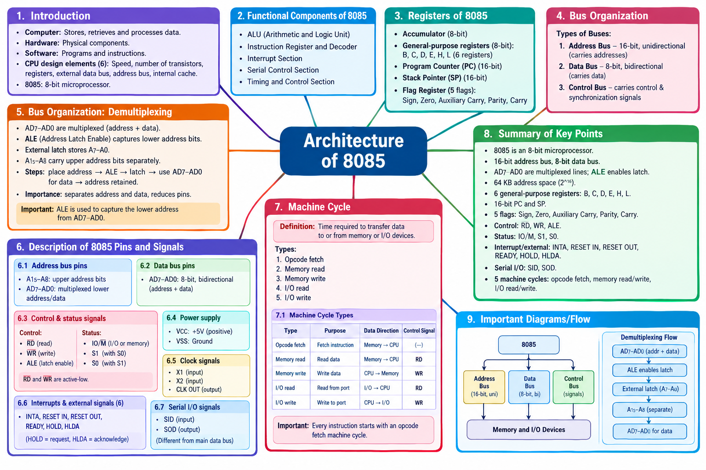

# LJ-MIT-sem3-chapter1-explained

---

# MIT — Chapter 1: Architecture of 8085

Source: Uploaded MIT Chapter 1 PPT · LJ Polytechnic

We will follow your requested workflow in order: Deep Explanation → Complete Text Mind Map → Mind Map Image → MCQs → 1-mark → 2-mark → 3-mark → 4/5-mark questions → Final Coverage Check.

I’ll preserve the PPT’s terminology and order, explain its diagrams and signals, and keep answers exam-oriented. I’ll also distinguish any additional standard explanation from facts explicitly listed in the PPT.

# STEP 1 — Deep Explanation

## 1. Introduction to Computer System

### 1.1 What is a computer?

A computer is a programmable electronic device that can store, retrieve, and process data. It manipulates data according to a list of instructions.

In simple words, a computer accepts data, follows instructions, processes the data, and produces useful results.

Example: When you add two numbers using a calculator program, the computer takes the numbers as input, performs the calculation, and displays the answer.

Input

Data and instructions

Processing

Computer executes instructions

Output

Useful result

### 1.2 Computer hardware

Definition: Computer hardware refers to the physical components of a computer.

Hardware consists of the parts that can be physically touched.

Examples:

- Keyboard
    
- Monitor
    
- CPU and microprocessor
    
- RAM
    
- Hard disk or SSD
    
- Motherboard
    

8085 example: The 8085 microprocessor is a hardware component that processes instructions and data.

### 1.3 Computer software

Definition: Software is a set of instructions or programs that directs hardware to perform particular tasks.

Software tells the hardware what operations to perform.

Examples:

- Operating systems
    
- Calculator applications
    
- Text editors
    
- Programs written in C or Python
    

Example: A calculator application provides instructions, while the processor executes those instructions to perform arithmetic operations.

### Hardware vs software

|Hardware|Software|
|---|---|
|Physical components of a computer|Programs and instructions|
|Can be physically touched|Cannot be physically touched as a physical component|
|Example: processor, RAM|Example: operating system, calculator program|
|Executes instructions or supports their execution|Specifies the tasks to be performed|

Important exam point: Hardware and software work together. Software provides instructions, and hardware executes them.

### 1.4 Six basic elements used to gauge CPU design performance and capability

According to the PPT, the six elements are:

|No.|Element|Simple explanation|
|---|---|---|
|1|Speed|How quickly the processor performs operations|
|2|Number of transistors|The number of electronic switching components used in the processor|
|3|Registers|Small, fast storage locations inside the CPU|
|4|External data bus|The data-carrying connection between the processor and external devices|
|5|Address bus|The connection used to specify memory locations or I/O addresses|
|6|Internal cache|Small, fast storage that keeps frequently needed data or instructions close to the processor|

These elements help describe and compare CPU designs. Their importance varies with the processor's design and intended use.

Remember all six in the PPT's order:

Speed → Transistors → Registers → External Data Bus → Address Bus → Internal Cache

## 2. Details of 8085 Architecture

### 2.1 What is the 8085 microprocessor?

The 8085 is an 8-bit microprocessor. It processes 8-bit data and communicates with external components through its address, data, and control signals.

The architecture of the 8085 describes the internal functional units, registers, buses, and control sections that work together to execute instructions.

### 2.2 Internal architecture of 8085

The PPT explains that 8-bit data enters the microprocessor through the multiplexed address/data bus AD7–AD0.

The term multiplexed means that the same physical pins perform different functions at different times. In the 8085, AD7–AD0 carry the lower eight address bits during one part of an operation and data during another.

The PPT identifies these functional components:

- Arithmetic and Logic Unit (ALU)
    
- Instruction Register and Decoder
    
- Interrupt section
    
- Serial Control Section
    
- Timing and Control Section
    

It also lists the register set separately.

### Simplified functional view of the 8085

AD7–AD0

Multiplexed address/data bus

ALU

Arithmetic and logical operations

Instruction Register and Decoder

Instruction handling

Interrupt Section

Interrupt handling

Serial Control Section

Serial data operations

Timing and Control Section

Coordinates processor operations

Study diagram: functional overview based on the PPT's listed components, not a pin-accurate reproduction of its original architecture diagram.

### 2.3 Arithmetic and Logic Unit (ALU)

Definition: The ALU is the part of a processor responsible for arithmetic and logical operations.

Its operations include:

- Arithmetic operations, such as addition and subtraction.
    
- Logical operations, such as AND, OR, and XOR.
    
- Updating status flags according to the result of relevant operations.
    

Example: If an instruction requires the processor to add two numbers, the ALU performs the addition.

### 2.4 Instruction Register and Decoder

The instruction register and decoder help the processor handle instructions.

- Instruction Register: Holds the instruction opcode being processed.
    
- Instruction Decoder: Interprets the opcode to determine which operation the processor must perform.
    

Example: When the processor fetches an instruction to add two values, the decoder interprets the opcode so that the appropriate operation can be carried out.

### 2.5 Interrupt section

Definition: An interrupt is a signal or event that requests the processor's attention and may cause it to temporarily suspend its current program flow to handle another task.

The interrupt section supports the processor's interrupt-handling operations.

Example: A peripheral device may request attention when it needs the processor to handle an event.

The 8085's interrupt-related pins and signals are covered in the pin-description section below in the PPT's sequence.

### 2.6 Serial Control Section

The serial control section supports serial input and output.

Serial communication transfers data one bit at a time over a serial data path.

The 8085 has two serial data signals listed in the PPT:

- SID: Serial Input Data
    
- SOD: Serial Output Data
    

For example, a serial input bit can be received through SID, while a serial output bit can be sent through SOD.

### 2.7 Timing and Control Section

Definition: The timing and control section coordinates the timing and control signals required for processor operations.

It helps coordinate activities such as memory reads, memory writes, and I/O operations.

For example, when the processor reads data from memory, the appropriate control signals indicate the type and timing of the operation.

Exam point: Remember the five functional components listed in the PPT, and distinguish them from the register set, which is presented separately.

### 2.8 Register Set of 8085

A register is a small, high-speed storage location inside the microprocessor used to hold data, addresses, instructions, or intermediate results.

The PPT identifies the following elements in the 8085 register set:

1. Accumulator
    
2. General-purpose registers
    
3. Program counter
    
4. Stack pointer
    
5. Flag register
    

#### A. Accumulator

The Accumulator (A) is an 8-bit register used extensively in arithmetic and logical operations.

It stores operands and results of many ALU operations.

Example: Suppose the accumulator contains 05H and the processor adds 03H to it. The result is 08H.

```
Accumulator (A) = 05H
          +
       Operand = 03H
          |
          v
Accumulator (A) = 08H
```

Here, `H` denotes hexadecimal notation.

#### B. General-purpose registers

The 8085 has six 8-bit general-purpose registers:

B, C, D, E, H and L

|Register|Size|General use|
|---|---|---|
|B|8 bits|Temporary data storage|
|C|8 bits|Temporary data storage|
|D|8 bits|Temporary data storage|
|E|8 bits|Temporary data storage|
|H|8 bits|Temporary data storage|
|L|8 bits|Temporary data storage|

These registers store data temporarily while instructions are executed.

The registers can also be combined into register pairs:

- BC
    
- DE
    
- HL
    

Each pair can hold 16 bits. The HL pair is also commonly used to hold a memory address.

#### C. Program Counter (PC)

The Program Counter (PC) is a 16-bit register that holds the address of the next instruction byte to be fetched.

After an instruction byte is fetched, the PC is normally updated to point to the next byte, although control-transfer instructions can change its value.

Example: If the next instruction byte is located at memory address 2050H, the PC may contain 2050H before that byte is fetched.

```
Program Counter
      |
      v
   2050H
      |
      v
Memory location 2050H
      |
      v
Instruction byte fetched
```

Exam point: The PC is 16 bits wide because the 8085 uses a 16-bit address bus.

#### D. Stack Pointer (SP)

The Stack Pointer (SP) is a 16-bit register that holds the address of the top of the stack.

A stack is a memory area used for temporary storage, including return addresses and saved data.

In the 8085, stack operations conventionally use memory, and the stack pointer is updated as data is pushed onto or popped from the stack.

Example: During a subroutine call, the return address can be saved on the stack so that execution can return to the correct location.

#### E. Flag Register

The Flag Register stores status information about the result of certain operations.

The PPT lists five flags:

- Carry flag (CY)
    
- Parity flag (P)
    
- Auxiliary Carry flag (AC)
    
- Zero flag (Z)
    
- Sign flag (S)
    

|Flag|Meaning|Simple explanation|
|---|---|---|
|Carry (CY)|Carry flag|Indicates a carry out of the most significant bit in addition, or a borrow in subtraction, as applicable|
|Parity (P)|Parity flag|Indicates whether the result has even parity|
|Auxiliary Carry (AC)|Auxiliary Carry flag|Indicates a carry between bit 3 and bit 4; relevant to certain arithmetic operations|
|Zero (Z)|Zero flag|Set when the relevant result is zero|
|Sign (S)|Sign flag|Reflects the most significant bit of the result|

Example: If an arithmetic or logical operation produces a zero result, the Zero flag is set.

Memory trick: S Z AC P CY — Sign, Zero, Auxiliary Carry, Parity, Carry.

### Register summary

|Register or group|Size|Main purpose|
|---|---|---|
|Accumulator|8 bits|Arithmetic/logical operations and results|
|B, C, D, E, H, L|8 bits each|General-purpose storage|
|Program Counter|16 bits|Address of the next instruction byte|
|Stack Pointer|16 bits|Address of the top of the stack|
|Flag Register|8-bit register, with five named status flags|Records status information|

## Step 1 progress

Covered so far:

- Introduction to Computer System
    
- Hardware and software
    
- Six CPU design performance and capability elements
    
- 8085 architecture overview
    
- ALU
    
- Instruction Register and Decoder
    
- Interrupt section
    
- Serial Control Section
    
- Timing and Control Section
    
- Accumulator
    
- General-purpose registers
    
- Program Counter
    
- Stack Pointer
    
- Flag Register
    

The next part of the explanation will cover Bus Organization of 8085, including the address bus, data bus, control bus, and demultiplexing using ALE, followed by the pin groups, machine cycles, and timing diagrams.

Say next to continue in the PPT's order.


---

# MIT — Chapter 1: Architecture of 8085

## STEP 1 — Deep Explanation (Continued)

## 3. Bus Organization of 8085

### 3.1 What is a bus?

Definition: A bus is a group of conducting wires used to carry information between the microprocessor and other devices.

Memory and peripheral devices communicate with the 8085 through buses.

For example, when the 8085 reads a value from memory, it sends the memory address, indicates the required operation, and receives the data.

The PPT describes three types of buses:

1. Address Bus
    
2. Data Bus
    
3. Control Bus
    

8085 Microprocessor

Address Bus

Selects a location

Data Bus

Transfers data

Control Bus

Controls operations

Memory and Peripheral Devices

### 3.2 Address Bus

Definition: The address bus is a 16-bit, unidirectional bus that carries the address of a memory location or the port number of a peripheral device.

- 16-bit: It consists of 16 address lines.
    
- Unidirectional: Address information travels outward from the processor.
    
- It identifies the memory location or I/O port involved in an operation.
    

The 8085 has 16 address bits, so it can address up to:

216=65,536 bytes=64 KB2^{16}=65,536\text{ bytes}=64\text{ KB}216=65,536 bytes=64 KB

This is the theoretical address space for memory when all 16 address bits are used.

Example: If the processor needs to read data from address `2050H`, it places that address on the address bus.

```
8085 ───── Address 2050H ─────► Memory
```

Important exam point: Address bus = 16-bit and unidirectional.

### 3.3 Data Bus

Definition: The data bus is a bidirectional bus that transfers data between the microprocessor and peripheral devices.

According to the PPT, the 8085 has an 8-bit bidirectional data bus.

- 8-bit: It can transfer 8 bits of data at a time.
    
- Bidirectional: Data can travel to or from the processor, depending on the operation.
    
- The same data bus can be used to receive data from memory or send data to memory.
    

Example: During a memory read, data travels from memory to the processor.

```
Memory ───── Data ─────► 8085
```

During a memory write, data travels from the processor to memory.

```
8085 ───── Data ─────► Memory
```

Important exam point: Data bus = 8-bit and bidirectional.

### 3.4 Control Bus

Definition: The control bus consists of signal lines that carry control and synchronization information between the microprocessor and peripheral devices.

These signals coordinate the operations of the system.

Examples of relevant 8085 signals include:

- RD: Read control signal
    
- WR: Write control signal
    
- ALE: Address Latch Enable
    

The PPT also identifies status signals, which are explained in the pin-description section.

Example: During a memory read, the processor uses the appropriate control signals to indicate that memory should provide data.

### 3.5 Difference between the three buses

|Feature|Address Bus|Data Bus|Control Bus|
|---|---|---|---|
|Main purpose|Carries addresses|Carries data|Carries control and synchronization signals|
|Width in the 8085|16-bit|8-bit|Multiple signal lines|
|Direction|Unidirectional|Bidirectional|Depends on the signal|
|Example|A15–A8 and AD7–AD0 during the address phase|AD7–AD0 during the data phase|RD, WR, ALE|

## 4. Bus Organization of 8085: Demultiplexing

### 4.1 What is multiplexing?

In the 8085, the lower eight address lines and the eight data lines share the same physical pins, named AD7–AD0.

These pins perform two different functions at different times:

- During the address phase, they carry the lower eight address bits.
    
- During the data phase, they carry data.
    

This arrangement is called a multiplexed address/data bus.

The advantage is that the processor can use fewer physical pins.

### 4.2 Why is demultiplexing required?

A peripheral or memory interface needs to distinguish the address from the data.

If the same pins carry both, the lower address must be captured before those pins are reused to carry data.

Demultiplexing separates the address information from the shared address/data lines so the address remains available independently during the data transfer.

### 4.3 Role of ALE

ALE stands for Address Latch Enable.

The processor generates ALE to indicate when the lower address bits on AD7–AD0 should be captured by an external latch.

The latch holds the lower address bits while AD7–AD0 are subsequently used for data.

### Demultiplexing process

8085: AD7–AD0

Carries lower address bits first, then data

Address captured when ALE enables the latch

External Latch

Stores the lower 8 address bits

A7–A0

Lower address retained by latch

AD7–AD0

Available for data transfer

The upper address bits are carried separately on A15–A8.

### 4.4 Steps of demultiplexing

1. The 8085 places the lower address bits on AD7–AD0.
    
2. ALE indicates that the address is available to be captured.
    
3. An external latch stores the lower address bits.
    
4. The AD7–AD0 pins can then be used for data transfer.
    
5. The captured address remains available while the data transfer takes place.
    

Why is demultiplexing important?

- It separates address and data information.
    
- It allows the same processor pins to perform two functions.
    
- It helps reduce the number of pins required by the 8085.
    

Important exam point: ALE is used to capture the lower address from the multiplexed AD7–AD0 lines.

## 5. Description of 8085 Pins and Signals

The PPT introduces seven groups of pins and signals. We will cover each group in the order shown in the slides.

### 5.1 Address bus pins

The PPT identifies A15–A8 as the upper address lines.

- These carry the most significant eight bits of the memory or I/O address.
    
- They are separate from the multiplexed AD7–AD0 lines.
    

The full address is formed using the upper and lower address bits:

```
        16-bit address
┌───────────────────────┬───────────────────────┐
│ A15–A8                │ AD7–AD0                │
│ Upper 8 address bits  │ Lower 8 address bits   │
└───────────────────────┴───────────────────────┘
```

During the address phase, AD7–AD0 carry the lower address bits. During the data phase, they carry data.

Exam point: A15–A8 = upper address bits; AD7–AD0 = multiplexed lower address/data lines.

### 5.2 Data bus pins

The PPT identifies AD7–AD0 as the multiplexed address/data lines.

Their two functions are:

1. Carry the lower eight address bits during the address phase.
    
2. Carry eight-bit data during the data phase.
    

They are bidirectional for data transfer.

### 5.3 Control and status signals

The PPT divides these into three control signals and three status signals.

Control signals

|Signal|Full form|Function|
|---|---|---|
|RD|Read|Indicates a read operation|
|WR|Write|Indicates a write operation|
|ALE|Address Latch Enable|Enables capturing the lower address bits|

Status signals

|Signal|Function|
|---|---|
|IO/M|Distinguishes I/O and memory operations|
|S1|Status output used with S0 to identify the operation|
|S0|Status output used with S1 to identify the operation|

The combination of IO/M, S1, and S0 helps identify the type of machine cycle.

Additional standard clarification: RD and WR are active-low signals on the 8085, meaning the operation is asserted when the signal is low.

### 5.4 Power supply signals

The PPT lists two power supply signals:

- VCC: Positive power supply.
    
- VSS: Ground reference.
    

These supply the electrical power and reference needed for the processor's operation.

Remember: VCC and VSS are power-related signals, not data or address lines.

### 5.5 Clock signals

The PPT lists three clock-related signals:

- X1
    
- X2
    
- CLK OUT
    

|Signal|Explanation|
|---|---|
|X1|Clock input connection|
|X2|Clock input connection|
|CLK OUT|Clock output signal provided by the processor|

X1 and X2 are associated with the clock-generating circuit. CLK OUT can provide a clock signal for external devices.

Example: Digital circuits use clock signals to coordinate when operations take place.

### 5.6 Interrupts and externally initiated signals

The PPT's slide lists the following signals:

- INTA
    
- RESET IN
    
- RESET OUT
    
- READY
    
- HOLD
    
- HLDA
    

Note that the slide calls these five interrupt signals but actually lists six signals. For complete study, all six must be remembered.

|Signal|Full form or meaning|Function|
|---|---|---|
|INTA|Interrupt Acknowledge|Indicates acknowledgment of an interrupt request|
|RESET IN|Reset input|Resets the processor|
|RESET OUT|Reset output|Provides a reset indication for external system components|
|READY|Ready input|Allows the processor to accommodate slower devices|
|HOLD|Hold request|Requests control of the system buses|
|HLDA|Hold Acknowledge|Indicates acknowledgment of the HOLD request|

#### Understanding HOLD and HLDA

HOLD and HLDA work together when an external device requests control of the buses.

```
External device requests bus
           |
           v
       HOLD signal
           |
           v
8085 acknowledges the request
           |
           v
       HLDA signal
           |
           v
External device can use the buses
```

This arrangement is useful when another device needs access to the system buses, such as during direct memory access.

Exam point: HOLD is the request; HLDA is the acknowledgment.

### 5.7 Serial I/O signals

The PPT lists two serial signals:

- SOD: Serial Output Data
    
- SID: Serial Input Data
    

|Signal|Direction relative to 8085|Purpose|
|---|---|---|
|SID|Input|Receives serial data|
|SOD|Output|Sends serial data|

Example: A bit received from an external serial source can enter through SID. A bit sent by the processor can leave through SOD.

Important distinction: The serial data pins are different from the main eight-bit multiplexed data bus.

## 6. Machine Cycle

### 6.1 Definition

According to the PPT, a machine cycle is the time required to transfer data to or from memory or I/O devices. Each read or write operation constitutes a machine cycle.

In simple terms, a machine cycle represents the processor's bus activity needed to carry out a particular operation.

The PPT covers these phases:

1. Opcode fetch
    
2. Memory read and write operations
    
3. I/O read and write operations
    

The slides also include timing diagrams for these operations.

### 6.2 Opcode fetch machine cycle

Definition: An opcode fetch machine cycle is the cycle in which the processor fetches (reads) the opcode of an instruction from memory.

The PPT states that every instruction starts with an opcode fetch machine cycle.

The opcode tells the processor which operation to perform.

#### Simplified opcode-fetch flow

```
Program Counter contains address
             |
             v
8085 places address on address bus
             |
             v
Memory provides the opcode
             |
             v
8085 reads the opcode
             |
             v
Instruction is decoded
```

The Program Counter identifies the address from which the instruction byte is fetched.

An instruction may contain additional bytes for data or an address, so further machine cycles may be needed after the opcode fetch.

Exam points:

- Every instruction begins with an opcode fetch machine cycle.
    
- The opcode is read from memory.
    
- The opcode tells the processor which operation to execute.
    

### 6.3 Memory read machine cycle

A memory read occurs when the processor obtains data from a memory location.

#### Simplified sequence

1. The processor places the memory address on the address bus.
    
2. The appropriate read control signal indicates a read operation.
    
3. Memory places the requested data on the data bus.
    
4. The processor reads the data.
    
    8085 ─── Address ───► Memory  
    8085 ─── Read control ───► Memory  
    8085 ◄──── Data ───── Memory
    

Example: The processor reads a stored value from a particular RAM location.

### 6.4 Memory write machine cycle

A memory write occurs when the processor sends data to a memory location.

#### Simplified sequence

1. The processor places the target memory address on the address bus.
    
2. It places the data to be written on the data bus.
    
3. The write control signal indicates the write operation.
    
4. Memory stores the data at the specified address.
    
    8085 ─── Address ───► Memory  
    8085 ─── Data ──────► Memory  
    8085 ─── Write control ─► Memory
    

Example: A processor instruction stores the result of a calculation in RAM.

### 6.5 Memory read vs memory write

|Feature|Memory Read|Memory Write|
|---|---|---|
|Purpose|Obtain data from memory|Store data in memory|
|Data direction|Memory → processor|Processor → memory|
|Control signal|RD|WR|
|Example|Read a value from RAM|Store a result in RAM|

### 6.6 I/O read machine cycle

An I/O read occurs when the processor reads data from an input/output port.

#### Simplified sequence

1. The processor identifies the I/O port.
    
2. The status signals indicate an I/O operation.
    
3. The read control signal indicates that data should be read.
    
4. The I/O device provides data to the processor.
    
    8085 ─── Port address ───► I/O device  
    8085 ─── Read control ───► I/O device  
    8085 ◄──── Data ───────── I/O device
    

Example: The processor reads a value from an input interface connected to a peripheral.

### 6.7 I/O write machine cycle

An I/O write occurs when the processor sends data to an output port or I/O device.

#### Simplified sequence

1. The processor identifies the I/O port.
    
2. The processor places the output data on the data bus.
    
3. The control signals indicate an I/O write.
    
4. The I/O device accepts the data.
    
    8085 ─── Port address ───► I/O device  
    8085 ─── Data ───────────► I/O device  
    8085 ─── Write control ──► I/O device
    

Example: The processor sends a value to an output interface that controls an external display.

### 6.8 I/O read vs I/O write

|Feature|I/O Read|I/O Write|
|---|---|---|
|Purpose|Obtain data from an I/O port|Send data to an I/O port|
|Data direction|I/O device → processor|Processor → I/O device|
|Control signal|RD|WR|
|Example|Read input data|Send output data|

### 6.9 Understanding machine-cycle timing diagrams

The PPT includes timing diagrams for opcode fetch, memory read, memory write, I/O read, and I/O write.

A timing diagram shows how address, data, and control signals change over time. It helps explain when the processor places an address on the bus, when data is available, and when the read or write operation occurs.

A typical read operation involves these ideas:

- The address becomes available.
    
- The appropriate control signals identify the operation.
    
- The data becomes available on the bus.
    
- The processor reads the data at the appropriate time.
    

A write operation follows the same general coordination principle, but the processor supplies the data.

Important source limitation: The extracted PPT text confirms that the five timing-diagram categories are present, but it does not expose the individual waveform labels and transitions. The explanations above describe their operation without claiming to reproduce every timing detail of the original diagrams.

# Chapter Summary

- A computer stores, retrieves, and processes data according to instructions.
    
- Hardware consists of physical components; software consists of programs and instructions.
    
- The PPT identifies six CPU design performance and capability elements: speed, number of transistors, registers, external data bus, address bus, and internal cache.
    
- The 8085 is an 8-bit microprocessor.
    
- Its functional components include the ALU, Instruction Register and Decoder, interrupt section, Serial Control Section, and Timing and Control Section.
    
- Its register set includes the accumulator, six general-purpose registers, PC, SP, and flag register.
    
- The 8085 has a 16-bit address bus and an 8-bit data bus.
    
- AD7–AD0 are multiplexed address/data pins; ALE enables capture of the lower address bits.
    
- The pin groups cover address, data, control/status, power, clock, interrupt/external control, and serial I/O.
    
- The machine-cycle topics in the PPT are opcode fetch, memory read/write, and I/O read/write.
    

# Important Definitions

|Term|Definition|
|---|---|
|Computer|A programmable electronic device that stores, retrieves, and processes data|
|Hardware|Physical components of a computer|
|Software|Programs and instructions that direct hardware to perform tasks|
|Register|A small, high-speed storage location in the processor|
|Address bus|A 16-bit unidirectional bus in the 8085 that carries addresses|
|Data bus|An 8-bit bidirectional bus that transfers data|
|Control bus|Signal lines carrying control and synchronization information|
|Multiplexing|Using the same physical lines for different functions at different times|
|Demultiplexing|Separating address and data information carried on shared lines|
|ALE|Address Latch Enable|
|Machine cycle|The time required for a transfer to or from memory or I/O, as described in the PPT|
|Opcode fetch|The machine cycle in which an instruction's opcode is read from memory|

# Important Differences

|Comparison|First term|Second term|
|---|---|---|
|Hardware vs software|Physical components|Programs and instructions|
|Address vs data bus|16-bit, unidirectional|8-bit, bidirectional|
|PC vs SP|Holds the address of the next instruction byte|Holds the address of the top of the stack|
|Memory read vs write|Reads data from memory|Writes data to memory|
|I/O read vs write|Reads data from an I/O port|Sends data to an I/O port|
|SID vs SOD|Serial input|Serial output|
|HOLD vs HLDA|Bus request|Hold acknowledgment|
|RD vs WR|Read control|Write control|

# Important Exam Points

1. The 8085 is an 8-bit microprocessor.
    
2. The address bus is 16-bit and unidirectional.
    
3. The data bus is 8-bit and bidirectional.
    
4. The 8085 can address up to 64 KB of memory in its 16-bit address space.
    
5. AD7–AD0 are multiplexed address/data lines.
    
6. ALE is used to capture the lower eight address bits.
    
7. There are six general-purpose registers: B, C, D, E, H and L.
    
8. PC and SP are 16-bit registers.
    
9. The five named flags are Sign, Zero, Auxiliary Carry, Parity, and Carry.
    
10. The PPT lists RD, WR, and ALE as control signals.
    
11. IO/M, S1, and S0 are the listed status signals.
    
12. The PPT's interrupt/external-signal slide lists six signals: INTA, RESET IN, RESET OUT, READY, HOLD, and HLDA.
    
13. SID is serial input; SOD is serial output.
    
14. Every instruction starts with an opcode fetch machine cycle.
    
15. The five timing-diagram categories are opcode fetch, memory read, memory write, I/O read, and I/O write.
    

## STEP 1 complete

The deep explanation of the chapter has now covered the extracted PPT topics in order. Next, we will move to STEP 2 — Complete Mind Map, followed by the requested mind map image in Step 3.

Say next to continue.

---


---
# STEP 2 — Complete Mind Map

## MIT Chapter 1: Architecture of 8085

This text mind map follows the PPT's chapter outline and includes its major topics, subtopics, register set, signal groups, and machine-cycle categories.

```
MIT — CHAPTER 1: ARCHITECTURE OF 8085
│
├── 1. INTRODUCTION TO COMPUTER SYSTEM
│   │
│   ├── Computer
│   │   ├── Programmable electronic device
│   │   ├── Stores data
│   │   ├── Retrieves data
│   │   └── Processes data using instructions
│   │
│   ├── Hardware
│   │   └── Physical components of a computer
│   │
│   ├── Software
│   │   └── Instructions/programs directing hardware
│   │
│   └── Six CPU Performance and Capability Elements
│       ├── Speed
│       ├── Number of transistors
│       ├── Registers
│       ├── External data bus
│       ├── Address bus
│       └── Internal cache
│
├── 2. DETAILS OF 8085 ARCHITECTURE
│   │
│   ├── 8085 Microprocessor
│   │   ├── 8-bit processor
│   │   └── Data enters through multiplexed AD7–AD0
│   │
│   ├── Functional Components
│   │   ├── Arithmetic and Logic Unit (ALU)
│   │   ├── Instruction Register and Decoder
│   │   ├── Interrupt Section
│   │   ├── Serial Control Section
│   │   └── Timing and Control Section
│   │
│   └── Register Set
│       ├── Accumulator (A)
│       ├── General-purpose registers
│       │   ├── B
│       │   ├── C
│       │   ├── D
│       │   ├── E
│       │   ├── H
│       │   └── L
│       ├── Program Counter (PC)
│       ├── Stack Pointer (SP)
│       └── Flag Register
│           ├── Carry Flag (CY)
│           ├── Parity Flag (P)
│           ├── Auxiliary Carry Flag (AC)
│           ├── Zero Flag (Z)
│           └── Sign Flag (S)
│
├── 3. BUS ORGANIZATION OF 8085
│   │
│   ├── Address Bus
│   │   ├── 16-bit
│   │   ├── Unidirectional
│   │   └── Carries memory addresses / I/O port numbers
│   │
│   ├── Data Bus
│   │   ├── 8-bit
│   │   ├── Bidirectional
│   │   └── Transfers data
│   │
│   ├── Control Bus
│   │   ├── Control signals
│   │   └── Synchronization / handshaking
│   │
│   └── Demultiplexing
│       ├── AD7–AD0 share address and data functions
│       ├── Reduces the required number of pins
│       ├── ALE = Address Latch Enable
│       ├── External latch captures lower address bits
│       └── Separates address retention from data transfer
│
├── 4. DESCRIPTION OF 8085 PINS AND SIGNALS
│   │
│   ├── Address Bus
│   │   └── A15–A8: upper 8 address bits
│   │
│   ├── Data Bus
│   │   └── AD7–AD0: lower address/data lines
│   │
│   ├── Control Signals
│   │   ├── RD — Read
│   │   ├── WR — Write
│   │   └── ALE — Address Latch Enable
│   │
│   ├── Status Signals
│   │   ├── IO/M
│   │   ├── S1
│   │   └── S0
│   │
│   ├── Power Supply Signals
│   │   ├── VCC
│   │   └── VSS
│   │
│   ├── Clock Signals
│   │   ├── X1
│   │   ├── X2
│   │   └── CLK OUT
│   │
│   ├── Interrupts and Externally Initiated Signals
│   │   ├── INTA
│   │   ├── RESET IN
│   │   ├── RESET OUT
│   │   ├── READY
│   │   ├── HOLD
│   │   └── HLDA
│   │
│   └── Serial I/O Signals
│       ├── SID — Serial Input Data
│       └── SOD — Serial Output Data
│
└── 5. MACHINE CYCLE
    │
    ├── Definition
    │   └── Time required for transfer to/from memory or I/O
    │
    ├── Opcode Fetch
    │   ├── Reads opcode from memory
    │   └── Starts every instruction
    │
    ├── Memory Operations
    │   ├── Memory Read
    │   │   └── Memory → Processor
    │   └── Memory Write
    │       └── Processor → Memory
    │
    ├── I/O Operations
    │   ├── I/O Read
    │   │   └── I/O Device → Processor
    │   └── I/O Write
    │       └── Processor → I/O Device
    │
    └── Timing Diagrams
        ├── Opcode Fetch
        ├── Memory Read
        ├── Memory Write
        ├── I/O Read
        └── I/O Write
```

Mind map coverage: All five main headings in the PPT outline are represented, including the six CPU evaluation elements, the register set, the listed pin signals, and all five machine-cycle timing-diagram categories.

# STEP 4 — MCQs with Answers

MIT · Chapter 1: Architecture of 8085

These MCQs cover the chapter from computer-system fundamentals through the 8085 architecture, registers, buses, pin signals, and machine cycles. Each answer appears immediately after its question.

## Section A — Introduction to Computer System

Q1. What is a computer?

A) A device used only for calculations B) A programmable electronic device that stores, retrieves, and processes data C) A device used only for data storage D) A mechanical device without instructions

Answer: B) A programmable electronic device that stores, retrieves, and processes data

Q2. Which of the following refers to the physical components of a computer?

A) Software B) Instructions C) Hardware D) Programs

Answer: C) Hardware

Q3. What is software?

A) A collection of physical wires B) A set of instructions or programs that directs hardware C) A type of processor register D) A memory address

Answer: B) A set of instructions or programs that directs hardware

Q4. Which of the following is NOT one of the six CPU design performance and capability elements listed in the PPT?

A) Speed B) Number of transistors C) Internal cache D) Monitor resolution

Answer: D) Monitor resolution

Q5. Which of the following is included among the six CPU design elements?

A) Keyboard size B) Internal cache C) Monitor brightness D) Printer speed

Answer: B) Internal cache

Q6. Which list correctly contains all six elements listed in the PPT?

A) Speed, transistors, registers, external data bus, address bus, internal cache B) Speed, monitor, keyboard, RAM, mouse, printer C) Registers, software, display, keyboard, power supply, mouse D) Cache, monitor, printer, operating system, keyboard, speed

Answer: A) Speed, transistors, registers, external data bus, address bus, internal cache

## Section B — Details of 8085 Architecture

Q7. The 8085 is primarily classified as which type of microprocessor?

A) 4-bit B) 8-bit C) 16-bit D) 32-bit

Answer: B) 8-bit

Q8. Through which pins does the 8085 receive data using its multiplexed address/data bus?

A) A15–A8 B) X1–X2 C) AD7–AD0 D) S1–S0

Answer: C) AD7–AD0

Q9. Which component performs arithmetic and logical operations?

A) Program Counter B) ALU C) Stack Pointer D) Address Bus

Answer: B) ALU

Q10. What is the primary function of the Instruction Decoder?

A) Supply power to the processor B) Store every program permanently C) Interpret the instruction opcode D) Carry addresses to memory

Answer: C) Interpret the instruction opcode

Q11. Which section of the 8085 handles interrupt-related operations?

A) Interrupt section B) Address bus C) Accumulator D) Power supply section

Answer: A) Interrupt section

Q12. Which section supports serial input/output operations?

A) ALU B) Serial Control Section C) Address bus D) Stack Pointer

Answer: B) Serial Control Section

Q13. Which section coordinates processor timing and control signals?

A) General-purpose register set B) Timing and Control Section C) Accumulator D) Data storage section

Answer: B) Timing and Control Section

## Section C — Register Set

Q14. How many 8-bit general-purpose registers are identified in the PPT?

A) Four B) Five C) Six D) Eight

Answer: C) Six

Q15. Which of the following is the correct set of general-purpose registers in the 8085?

A) A, B, C, D, E, F B) B, C, D, E, H, L C) A, C, D, F, H, SP D) PC, SP, B, C, D, E

Answer: B) B, C, D, E, H, L

Q16. Which register is extensively used in arithmetic and logical operations?

A) Accumulator B) Program Counter C) Stack Pointer D) Instruction Decoder

Answer: A) Accumulator

Q17. What is the size of the Program Counter in the 8085?

A) 4 bits B) 8 bits C) 12 bits D) 16 bits

Answer: D) 16 bits

Q18. What does the Program Counter hold?

A) The result of every addition B) The address of the next instruction byte to be fetched C) The current power supply voltage D) The contents of the data bus permanently

Answer: B) The address of the next instruction byte to be fetched

Q19. Which register holds the address of the top of the stack?

A) Accumulator B) Program Counter C) Stack Pointer D) Flag Register

Answer: C) Stack Pointer

Q20. Which of the following is NOT one of the five named flags listed in the PPT?

A) Carry B) Zero C) Sign D) Overflow

Answer: D) Overflow

Q21. Which flag indicates that the relevant operation has produced a zero result?

A) Carry flag B) Zero flag C) Sign flag D) Auxiliary Carry flag

Answer: B) Zero flag

Q22. Which flag indicates even parity of the result?

A) Parity flag B) Sign flag C) Zero flag D) Carry flag

Answer: A) Parity flag

## Section D — Bus Organization

Q23. What is the width of the 8085 address bus?

A) 4 bits B) 8 bits C) 16 bits D) 32 bits

Answer: C) 16 bits

Q24. The address bus of the 8085 is:

A) Bidirectional B) Unidirectional C) Used only for data D) Used only for clock signals

Answer: B) Unidirectional

Q25. What is the width of the 8085 data bus?

A) 4 bits B) 8 bits C) 16 bits D) 20 bits

Answer: B) 8 bits

Q26. Why is the data bus described as bidirectional?

A) It carries only addresses B) It carries data both to and from the processor C) It carries only clock pulses D) It carries only reset signals

Answer: B) It carries data both to and from the processor

Q27. Which bus carries control and synchronization signals?

A) Address Bus B) Data Bus C) Control Bus D) Register Bus only

Answer: C) Control Bus

Q28. What is the maximum address space of a 16-bit address bus?

A) 8 KB B) 16 KB C) 32 KB D) 64 KB

Answer: D) 64 KB

Q29. What does AD7–AD0 represent in the 8085?

A) Eight separate power supply pins B) Multiplexed lower address/data lines C) Sixteen address-only lines D) Clock input lines

Answer: B) Multiplexed lower address/data lines

Q30. What is the main reason for multiplexing address and data lines?

A) To increase the number of power pins B) To reduce the number of required processor pins C) To eliminate the need for memory D) To convert the processor into a 16-bit processor

Answer: B) To reduce the number of required processor pins

Q31. What is the full form of ALE?

A) Address Logic Enable B) Automatic Latch Execution C) Address Latch Enable D) Address Line Extension

Answer: C) Address Latch Enable

Q32. What is the primary purpose of ALE in demultiplexing?

A) To store arithmetic results B) To enable capture of the lower address bits C) To reset the processor D) To send serial output data

Answer: B) To enable capture of the lower address bits

Q33. Which pins carry the upper eight address bits?

A) AD7–AD0 B) A15–A8 C) X1–X2 D) SID–SOD

Answer: B) A15–A8

## Section E — Pin and Signal Description

Q34. Which three signals are identified as control signals in the PPT?

A) RD, WR, ALE B) IO/M, S1, S0 C) X1, X2, VCC D) SID, SOD, HLDA

Answer: A) RD, WR, ALE

Q35. Which three signals are identified as status signals in the PPT?

A) RD, WR, ALE B) IO/M, S1, S0 C) SID, SOD, VCC D) X1, X2, CLK OUT

Answer: B) IO/M, S1, S0

Q36. What does RD indicate?

A) Reset operation B) Read operation C) Register division D) Clock generation

Answer: B) Read operation

Q37. What does WR indicate?

A) Write operation B) Wait for reset C) Word register D) Wireless reception

Answer: A) Write operation

Q38. Which pair represents the power supply signals listed in the PPT?

A) X1 and X2 B) RD and WR C) VCC and VSS D) SID and SOD

Answer: C) VCC and VSS

Q39. Which signal provides a clock output to external circuits?

A) RESET IN B) CLK OUT C) READY D) ALE

Answer: B) CLK OUT

Q40. Which signal acknowledges an interrupt?

A) HLDA B) INTA C) READY D) SOD

Answer: B) INTA

Q41. Which signal is used to reset the processor from an external source?

A) RESET IN B) RESET OUT C) CLK OUT D) SID

Answer: A) RESET IN

Q42. What is the purpose of READY?

A) To select the accumulator B) To accommodate slower devices by controlling processor wait states C) To send serial data D) To latch the lower address

Answer: B) To accommodate slower devices by controlling processor wait states

Q43. Which signal requests control of the system buses?

A) HLDA B) HOLD C) INTA D) S1

Answer: B) HOLD

Q44. Which signal acknowledges a HOLD request?

A) READY B) RESET OUT C) HLDA D) ALE

Answer: C) HLDA

Q45. Which pin receives serial input data?

A) SOD B) SID C) RD D) WR

Answer: B) SID

Q46. Which pin transmits serial output data?

A) SID B) SOD C) ALE D) IO/M

Answer: B) SOD

## Section F — Machine Cycles

Q47. What is a machine cycle, according to the PPT?

A) The time required to compile a program B) The time required for data transfer to or from memory or I/O C) The time required to manufacture a processor D) The time required to install software

Answer: B) The time required for data transfer to or from memory or I/O

Q48. Which machine cycle starts every instruction according to the PPT?

A) Memory write B) I/O read C) Opcode fetch D) I/O write

Answer: C) Opcode fetch

Q49. During an opcode fetch machine cycle, the processor:

A) Reads the instruction opcode from memory B) Writes a value to an I/O port C) Sends a reset signal to memory D) Transfers only serial output data

Answer: A) Reads the instruction opcode from memory

Q50. During a memory read operation, data normally travels in which direction?

A) Processor to memory B) Memory to processor C) Processor to clock circuit D) Serial output to serial input

Answer: B) Memory to processor

Q51. During a memory write operation, data normally travels in which direction?

A) Memory to processor B) Processor to memory C) Memory to clock circuit D) Processor to power supply

Answer: B) Processor to memory

Q52. During an I/O read operation, the processor:

A) Sends data to an output port B) Reads data from an I/O device or port C) Writes an opcode into the Program Counter D) Resets the entire system

Answer: B) Reads data from an I/O device or port

Q53. During an I/O write operation, data normally travels from:

A) The I/O device to the processor B) The processor to the I/O device C) The memory to the Program Counter D) The clock to the accumulator

Answer: B) The processor to the I/O device

Q54. Which set contains all five machine-cycle timing categories covered by the PPT?

A) Opcode fetch, memory read, memory write, I/O read, I/O write B) Addition, subtraction, multiplication, division, comparison C) Reset, clock, power, interrupt, serial input D) Fetch, compile, link, execute, install

Answer: A) Opcode fetch, memory read, memory write, I/O read, I/O write

Q55. Which control signal is associated with a read operation?

A) WR B) RD C) HOLD D) SOD

Answer: B) RD

Q56. Which control signal is associated with a write operation?

A) RD B) SID C) WR D) INTA

Answer: C) WR

Q57. Which register normally identifies the address of the next instruction byte to be fetched?

A) Stack Pointer B) Program Counter C) Accumulator D) Flag Register

Answer: B) Program Counter

Q58. In which type of diagram are changes in address, data, and control signals shown against time?

A) Flowchart only B) Timing diagram C) Organization chart D) Register table only

Answer: B) Timing diagram

## MCQ completion check

## MCQs completed: 58

The questions cover the main topics and subtopics extracted from the uploaded PPT, including all five machine-cycle categories and the signal names listed in the slides.

Coverage note: The PPT includes original architecture and timing diagrams. Their precise internal labels and waveform transitions were not fully available in the extracted text, so I have not invented diagram-specific details. Those exact visual details should be checked against the original slides.

The next section is STEP 5 — 1-Mark Questions, with each answer immediately after its question. Say next to continue.

---

# STEP 5 — 1-Mark Questions with Answers

MIT · Chapter 1: Architecture of 8085

These are short, exam-oriented questions covering definitions, full forms, register names, bus characteristics, pin signals, and direct facts from your PPT. Answers are kept concise for 1-mark examinations.

## A. Introduction to Computer System

Q1. Define a computer.

Answer: A computer is a programmable electronic device that stores, retrieves, and processes data according to instructions.

Q2. Define computer hardware.

Answer: Hardware refers to the physical components of a computer.

Q3. Define software.

Answer: Software is a set of instructions or programs that directs hardware to perform particular tasks.

Q4. State the six CPU design performance and capability elements listed in the PPT.

Answer: Speed, number of transistors, registers, external data bus, address bus, and internal cache.

Q5. Give one example of hardware.

Answer: Microprocessor.

Q6. Give one example of software.

Answer: Operating system.

## B. Details of 8085 Architecture

Q7. What is the 8085?

Answer: The 8085 is an 8-bit microprocessor.

Q8. Name the functional components of the 8085 listed in the PPT.

Answer: ALU, Instruction Register and Decoder, Interrupt Section, Serial Control Section, and Timing and Control Section.

Q9. What is the full form of ALU?

Answer: Arithmetic and Logic Unit.

Q10. State one function of the ALU.

Answer: It performs arithmetic and logical operations.

Q11. What is the function of the Instruction Decoder?

Answer: It interprets the instruction opcode to determine the operation to be performed.

Q12. What is an interrupt?

Answer: An interrupt is a signal or event that requests the processor's attention.

Q13. State the function of the Timing and Control Section.

Answer: It coordinates the timing and control signals required for processor operations.

Q14. What is the purpose of the Serial Control Section?

Answer: It supports serial input and output operations.

## C. Register Set

Q15. What is a register?

Answer: A register is a small, high-speed storage location inside a processor.

Q16. Name the accumulator register.

Answer: Accumulator (A).

Q17. What is the size of the accumulator?

Answer: 8 bits.

Q18. Name the six general-purpose registers of the 8085.

Answer: B, C, D, E, H, and L.

Q19. What is the size of each general-purpose register?

Answer: 8 bits.

Q20. What is the full form of PC?

Answer: Program Counter.

Q21. What is the size of the Program Counter?

Answer: 16 bits.

Q22. State the function of the Program Counter.

Answer: It holds the address of the next instruction byte to be fetched.

Q23. What is the full form of SP?

Answer: Stack Pointer.

Q24. State the function of the Stack Pointer.

Answer: It holds the address of the top of the stack.

Q25. Name the five flags listed in the PPT.

Answer: Carry, Parity, Auxiliary Carry, Zero, and Sign.

Q26. What does the Zero flag indicate?

Answer: It indicates that the relevant operation has produced a zero result.

Q27. What does the Parity flag indicate?

Answer: It indicates the parity of the result.

Q28. What does the Carry flag indicate?

Answer: It indicates a carry out of the most significant bit in addition or a borrow in subtraction, as applicable.

Q29. What does the Sign flag indicate?

Answer: It reflects the most significant bit of the relevant result.

Q30. What does the Auxiliary Carry flag indicate?

Answer: It indicates a carry between bit 3 and bit 4.

## D. Bus Organization

Q31. Define a bus.

Answer: A bus is a group of conducting wires that carries information between the microprocessor and other devices.

Q32. Name the three buses of the 8085 system.

Answer: Address Bus, Data Bus, and Control Bus.

Q33. What is the width of the address bus?

Answer: 16 bits.

Q34. Is the address bus unidirectional or bidirectional?

Answer: Unidirectional.

Q35. What is the width of the data bus?

Answer: 8 bits.

Q36. Is the data bus unidirectional or bidirectional?

Answer: Bidirectional.

Q37. What is the function of the address bus?

Answer: It carries the address of a memory location or I/O port.

Q38. What is the function of the data bus?

Answer: It transfers data between the microprocessor and external devices.

Q39. What is the function of the control bus?

Answer: It carries control and synchronization signals.

Q40. What is the maximum address space of a 16-bit address bus?

Answer: 64 KB.

Q41. What is multiplexing in the 8085?

Answer: It is the use of the same AD7–AD0 pins for lower address bits and data at different times.

Q42. What is demultiplexing?

Answer: Demultiplexing separates address information from data information carried on shared lines.

Q43. What is the full form of ALE?

Answer: Address Latch Enable.

Q44. What is the function of ALE?

Answer: It enables the external latch to capture the lower eight address bits from AD7–AD0.

Q45. Which pins carry the upper eight address bits?

Answer: A15–A8.

## E. Pin and Signal Description

Q46. Name the three control signals listed in the PPT.

Answer: RD, WR, and ALE.

Q47. Name the three status signals listed in the PPT.

Answer: IO/M, S1, and S0.

Q48. What is the full form of RD?

Answer: Read.

Q49. What is the full form of WR?

Answer: Write.

Q50. What does IO/M distinguish?

Answer: I/O operations from memory operations.

Q51. Name the two power supply signals.

Answer: VCC and VSS.

Q52. Name the three clock signals listed in the PPT.

Answer: X1, X2, and CLK OUT.

Q53. What is the function of CLK OUT?

Answer: It provides a clock output signal for external circuits.

Q54. What is the full form of INTA?

Answer: Interrupt Acknowledge.

Q55. What is the function of RESET IN?

Answer: It provides an external reset input to the processor.

Q56. What is the function of RESET OUT?

Answer: It provides a reset indication to external system components.

Q57. What is the function of READY?

Answer: It allows the processor to accommodate slower devices.

Q58. What is the function of HOLD?

Answer: It requests control of the system buses.

Q59. What is the full form of HLDA?

Answer: Hold Acknowledge.

Q60. What is the relationship between HOLD and HLDA?

Answer: HOLD requests bus control, while HLDA acknowledges the request.

Q61. What is the full form of SID?

Answer: Serial Input Data.

Q62. What is the full form of SOD?

Answer: Serial Output Data.

Q63. Which signal receives serial data?

Answer: SID.

Q64. Which signal transmits serial data?

Answer: SOD.

## F. Machine Cycle

Q65. Define a machine cycle according to the PPT.

Answer: A machine cycle is the time required to transfer data to or from memory or I/O devices.

Q66. Which machine cycle starts every instruction according to the PPT?

Answer: Opcode fetch.

Q67. Define opcode fetch.

Answer: Opcode fetch is the machine cycle in which the processor reads the instruction opcode from memory.

Q68. What is a memory read operation?

Answer: It is an operation in which the processor obtains data from memory.

Q69. What is a memory write operation?

Answer: It is an operation in which the processor sends data to memory.

Q70. What is an I/O read operation?

Answer: It is an operation in which the processor reads data from an I/O device or port.

Q71. What is an I/O write operation?

Answer: It is an operation in which the processor sends data to an I/O device or port.

Q72. Which signal is associated with a read operation?

Answer: RD.

Q73. Which signal is associated with a write operation?

Answer: WR.

Q74. What is a timing diagram?

Answer: A timing diagram shows how signals change over time during an operation.

Q75. Name the five machine-cycle timing diagrams covered in the PPT.

Answer: Opcode Fetch, Memory Read, Memory Write, I/O Read, and I/O Write.

## 1-Mark Questions completion check

## 1-Mark Questions Completed: 75

Coverage includes definitions, full forms, registers, flags, bus properties, pin signals, and machine-cycle facts.

Any 1-mark topic/question left?

The extracted PPT topics are represented in this set. The exact waveform details in the original timing diagrams are not fully available in the extracted text, so diagram-specific questions requiring unverified waveform labels have not been invented.

The next section is STEP 6 — 2-Mark Questions, with slightly longer answers and short comparisons.

Say next to continue.

---

# STEP 6 — 2-Mark Questions with Answers

MIT · Chapter 1: Architecture of 8085

These questions require slightly more explanation than 1-mark questions. Answers are structured for short university/college exam responses, with comparisons and small diagrams wherever useful.

## A. Introduction to Computer System

Q1. Differentiate between hardware and software.

Answer:

|Hardware|Software|
|---|---|
|Physical components of a computer.|Programs and instructions that direct hardware.|
|Example: Microprocessor.|Example: Calculator program.|

Q2. State any two functions of a computer.

Answer:

1. It stores and retrieves data.
    
2. It processes data according to instructions.
    

Q3. List any four CPU design performance and capability elements mentioned in the PPT.

Answer:

1. Speed
    
2. Number of transistors
    
3. Registers
    
4. External data bus
    

Other listed elements are the address bus and internal cache.

## B. Details of 8085 Architecture

Q4. Name the five functional components of the 8085 listed in the PPT.

Answer:

1. Arithmetic and Logic Unit (ALU)
    
2. Instruction Register and Decoder
    
3. Interrupt Section
    
4. Serial Control Section
    
5. Timing and Control Section
    

Q5. State any two functions of the ALU.

Answer:

1. Performs arithmetic operations such as addition and subtraction.
    
2. Performs logical operations such as AND and OR.
    

Q6. What are the functions of the Instruction Register and Decoder?

Answer:

1. The Instruction Register holds the instruction opcode being processed.
    
2. The Decoder interprets the opcode to determine the required operation.
    

Q7. What is the purpose of the Interrupt Section?

Answer:

1. It supports the handling of interrupt requests.
    
2. It allows the processor to respond to events that require attention.
    

Q8. State the function of the Timing and Control Section.

Answer:

1. It coordinates the timing of processor operations.
    
2. It generates or coordinates control signals for operations such as memory and I/O transfers.
    

Q9. What is the function of the Serial Control Section?

Answer:

1. It supports serial data input.
    
2. It supports serial data output through the serial I/O facilities.
    

## C. Register Set

Q10. What is an accumulator? State its function.

Answer:

The accumulator is an 8-bit register in the 8085.

1. It holds operands used in many arithmetic and logical operations.
    
2. It stores results produced by many ALU operations.
    

Q11. List the six general-purpose registers of the 8085 and state their size.

Answer: The registers are B, C, D, E, H, and L. Each register is 8 bits wide.

Q12. Differentiate between the Program Counter and Stack Pointer.

Answer:

|Program Counter (PC)|Stack Pointer (SP)|
|---|---|
|Holds the address of the next instruction byte to be fetched.|Holds the address of the top of the stack.|
|16-bit register.|16-bit register.|

Q13. What is the purpose of the flag register?

Answer:

1. It stores status information about certain operations.
    
2. Its five named flags are Sign, Zero, Auxiliary Carry, Parity, and Carry.
    

Q14. Explain the function of the Zero and Carry flags.

Answer:

1. Zero flag: Set when the relevant result is zero.
    
2. Carry flag: Indicates a carry out of the most significant bit in addition or a borrow in subtraction, as applicable.
    

Q15. What is the purpose of the Parity and Sign flags?

Answer:

1. Parity flag: Indicates the parity of the result.
    
2. Sign flag: Reflects the most significant bit of the result.
    

Q16. State the function of the Auxiliary Carry flag.

Answer: The Auxiliary Carry flag indicates a carry between bit 3 and bit 4. It is relevant to certain arithmetic operations.

## D. Bus Organization

Q17. Define a bus and name its three types.

Answer: A bus is a group of conducting wires that carries information between the microprocessor and other devices.

The three types are:

1. Address Bus
    
2. Data Bus
    
3. Control Bus
    

Q18. Differentiate between the address bus and data bus.

Answer:

|Address Bus|Data Bus|
|---|---|
|16-bit wide in the 8085.|8-bit wide in the 8085.|
|Unidirectional.|Bidirectional.|
|Carries addresses.|Carries data.|

Q19. What is the function of the control bus? Give two examples of its signals.

Answer: The control bus carries control and synchronization information between the processor and external devices.

Examples: RD and WR.

Q20. Why can the 8085 address 64 KB of memory?

Answer:

The 8085 has a 16-bit address bus.

The number of distinct addresses is:

216=65,536 bytes=64 KB2^{16}=65,536\text{ bytes}=64\text{ KB}216=65,536 bytes=64 KB

Therefore, its 16-bit address space can address 64 KB of memory.

Q21. What is multiplexing in the 8085? Why is it used?

Answer:

1. Multiplexing means using the same physical pins for address and data at different times.
    
2. The 8085 uses AD7–AD0 for the lower address bits and data, reducing the number of required pins.
    

Q22. Explain the purpose of demultiplexing.

Answer:

1. It separates the lower address information from the shared address/data lines.
    
2. An external latch retains the lower address while AD7–AD0 are used for data transfer.
    

Q23. What is ALE? State its function.

Answer: ALE stands for Address Latch Enable.

1. It indicates when the lower address bits are available to be captured.
    
2. It enables an external latch to retain the lower address from AD7–AD0.
    

Q24. What is the role of an external latch in 8085 demultiplexing?

Answer:

1. It captures the lower eight address bits during the address phase.
    
2. It keeps those bits available while AD7–AD0 are reused for data transfer.
    

Q25. How is a 16-bit address formed in the 8085?

Answer: The address consists of two eight-bit parts:

- A15–A8: Upper eight address bits.
    
- AD7–AD0: Lower eight address bits during the address phase.
    

Together, they form the 16-bit address.

## E. Pin and Signal Description

Q26. Name the control and status signals listed in the PPT.

Answer:

- Control: RD, WR, ALE.
    
- Status: IO/M, S1, S0.
    

Q27. Differentiate between RD and WR.

Answer:

|RD|WR|
|---|---|
|Indicates a read operation.|Indicates a write operation.|
|Used when the processor reads data.|Used when the processor writes data.|

Q28. State the functions of IO/M, S1, and S0.

Answer:

1. IO/M distinguishes I/O operations from memory operations.
    
2. S1 and S0, used with IO/M, help identify the type of machine cycle.
    

Q29. Name the power and clock signals listed in the PPT.

Answer:

- Power signals: VCC and VSS.
    
- Clock signals: X1, X2, and CLK OUT.
    

Q30. State the functions of SID and SOD.

Answer:

1. SID: Receives serial input data.
    
2. SOD: Sends serial output data.
    

Q31. Differentiate between HOLD and HLDA.

Answer:

|HOLD|HLDA|
|---|---|
|Requests control of the system buses.|Acknowledges the HOLD request.|
|Request signal.|Acknowledgment signal.|

Q32. State the functions of READY and INTA.

Answer:

1. READY: Allows the processor to accommodate slower devices.
    
2. INTA: Indicates acknowledgment of an interrupt request.
    

Q33. Differentiate between RESET IN and RESET OUT.

Answer:

1. RESET IN is an external reset input to the processor.
    
2. RESET OUT provides a reset indication to external system components.
    

## F. Machine Cycles

Q34. Define a machine cycle and name its five timing categories in the PPT.

Answer: A machine cycle is the time required to transfer data to or from memory or I/O devices.

The five categories are:

1. Opcode fetch
    
2. Memory read
    
3. Memory write
    
4. I/O read
    
5. I/O write
    

Q35. What is an opcode fetch machine cycle? Why is it important?

Answer:

1. It is the cycle in which the processor reads the instruction opcode from memory.
    
2. The opcode identifies the operation the processor must perform. According to the PPT, every instruction starts with an opcode fetch cycle.
    

Q36. Differentiate between memory read and memory write.

Answer:

|Memory Read|Memory Write|
|---|---|
|Reads data from memory.|Writes data to memory.|
|Data flows from memory to the processor.|Data flows from the processor to memory.|

Q37. Differentiate between I/O read and I/O write.

Answer:

|I/O Read|I/O Write|
|---|---|
|Reads data from an I/O device or port.|Sends data to an I/O device or port.|
|Data flows from the device to the processor.|Data flows from the processor to the device.|

Q38. What is a timing diagram? State its importance.

Answer:

1. A timing diagram shows how signals change over time.
    
2. It helps explain the relationship between address, data, and control signals during a machine cycle.
    

Q39. What happens during a memory read operation?

Answer:

1. The processor places the memory address on the address bus.
    
2. Memory supplies the requested data, which the processor reads using the appropriate control signals.
    

Q40. What happens during a memory write operation?

Answer:

1. The processor places the target address and data on the relevant buses.
    
2. The write control signal indicates that memory should store the data.
    

Q41. How does the processor perform an I/O read?

Answer:

1. It identifies the I/O port and indicates an I/O read operation.
    
2. The I/O device provides the requested data to the processor.
    

Q42. How does the processor perform an I/O write?

Answer:

1. It identifies the I/O port and places the output data on the data bus.
    
2. The control signals indicate an I/O write so that the device can accept the data.
    

Q43. What is the difference between an instruction and an opcode?

Answer:

1. An instruction specifies an operation and may include additional data or address bytes.
    
2. An opcode is the part of an instruction that identifies the operation to be performed.
    

## 2-Mark Questions completion check

## 2-Mark Questions Completed: 43

All major extracted PPT topics have been represented, including short comparisons, signal functions, and machine-cycle operations.

Any important 2-mark question left?

The available PPT text supports the questions above. The exact timing values, T-state counts, and waveform transitions are not exposed in the extracted slide text, so they have not been added as source-derived facts.

Next is STEP 7 — 3-Mark Questions, with answers suitable for three-mark university/college examinations.

Say next to continue.


---

# STEP 7 — 3-Mark Questions with Answers

MIT · Chapter 1: Architecture of 8085

These answers are structured for 3-mark university/college examinations. They include definitions, explanations, three-point answers, comparisons, and simple diagrams.

## A. Introduction to Computer System

Q1. Explain the basic functions of a computer.

Answer:

A computer is a programmable electronic device that performs the following functions:

1. Storage: Stores data and instructions for later use.
    
2. Retrieval: Retrieves previously stored data when required.
    
3. Processing: Processes data according to the instructions provided by a program.
    

Example: A computer receives two numbers, adds them, and displays the result.

Q2. Explain the six CPU design performance and capability elements listed in the PPT.

Answer:

1. Speed: Determines how quickly the processor performs operations.
    
2. Number of transistors: Relates to the processor's internal complexity and implementation.
    
3. Registers: Provide fast internal storage for operands, addresses, and intermediate results.
    
4. External data bus: Determines how many data bits can be transferred in parallel.
    
5. Address bus: Determines the address range the processor can access.
    
6. Internal cache: Stores frequently needed instructions or data for faster access.
    

## B. Details of 8085 Architecture

Q3. Explain the main functional components of the 8085 microprocessor.

Answer:

The main functional components identified in the PPT are:

1. Arithmetic and Logic Unit (ALU): Performs arithmetic and logical operations.
    
2. Instruction Register and Decoder: Holds and interprets the instruction opcode.
    
3. Interrupt Section: Handles interrupt requests.
    
4. Serial Control Section: Supports serial input and output.
    
5. Timing and Control Section: Coordinates processor timing and control signals.
    

Together, these components allow the processor to fetch, interpret, and execute instructions.

Q4. Explain the role of the ALU, accumulator, and flag register.

Answer:

- ALU: Performs arithmetic and logical operations.
    
- Accumulator: An 8-bit register that holds operands and results for many ALU operations.
    
- Flag Register: Records status information about certain results through five flags: Sign, Zero, Auxiliary Carry, Parity, and Carry.
    

These components work together during arithmetic and logical instruction execution.

Q5. Explain the function of the Instruction Register and Decoder.

Answer:

1. The Instruction Register holds the opcode currently being processed.
    
2. The Instruction Decoder interprets the opcode.
    
3. The decoded instruction determines the operation and the control actions required for execution.
    

For example, an addition opcode causes the processor to perform the specified addition operation.

Q6. Explain the functions of the Program Counter and Stack Pointer.

Answer:

1. Program Counter (PC): A 16-bit register that holds the address of the next instruction byte to be fetched.
    
2. Stack Pointer (SP): A 16-bit register that holds the address of the top of the stack.
    
3. Both registers store addresses, but they serve different purposes: PC supports instruction sequencing, while SP supports stack operations.
    

Q7. Explain the five flags of the 8085.

Answer:

|Flag|Function|
|---|---|
|Sign (S)|Reflects the most significant bit of the result.|
|Zero (Z)|Indicates a zero result.|
|Auxiliary Carry (AC)|Indicates a carry between bit 3 and bit 4.|
|Parity (P)|Indicates the parity of the result.|
|Carry (CY)|Indicates a carry out of the most significant bit in addition or a borrow in subtraction, as applicable.|

These flags provide status information used by certain instructions, including conditional operations.

## C. Bus Organization

Q8. Explain the three types of buses used in the 8085 system.

Answer:

1. Address Bus: A 16-bit, unidirectional bus that carries addresses.
    
2. Data Bus: An 8-bit, bidirectional bus that transfers data.
    
3. Control Bus: Carries control and synchronization signals such as read and write controls.
    

Simple representation:

```
             +----------------+
             | 8085 Processor |
             +----------------+
                |     |     |
             Address Data Control
              Bus    Bus    Bus
                |     |     |
                +-----+-----+
                      |
              Memory and I/O
```

Q9. Differentiate between the address bus, data bus, and control bus.

Answer:

|Feature|Address Bus|Data Bus|Control Bus|
|---|---|---|---|
|Purpose|Carries addresses|Carries data|Carries control signals|
|Width in 8085|16 bits|8 bits|Multiple control lines|
|Direction|Unidirectional|Bidirectional|Depends on the signal|

Q10. Explain why the 8085 can address 64 KB of memory.

Answer:

The 8085 has a 16-bit address bus.

The total number of unique addresses is:

216=65,5362^{16}=65,536216=65,536

Since each address identifies one byte, the addressable memory space is 65,536 bytes, or 64 KB.

Q11. Explain multiplexing of address and data lines in the 8085.

Answer:

1. The 8085 uses AD7–AD0 for both the lower eight address bits and data.
    
2. These functions occur at different times during a bus operation.
    
3. Multiplexing reduces the number of pins required by the processor.
    

During the address phase, AD7–AD0 carry the lower address. During the data phase, the same pins carry data.

Q12. Explain demultiplexing using ALE and an external latch.

Answer:

1. At the beginning of a bus operation, AD7–AD0 carry the lower eight address bits.
    
2. ALE (Address Latch Enable) enables an external latch to capture these bits.
    
3. The latch retains the lower address while AD7–AD0 are reused for data transfer.
    
    8085 AD7–AD0  
    |  
    +------> External Latch ------> Lower Address  
    |  
    +<----------------------------> Data Transfer
    
    8085 ALE ---------------------------> Latch Enable
    

This arrangement separates the address from the subsequently transferred data.

## D. Pin and Signal Description

Q13. Explain the functions of RD, WR, and ALE.

Answer:

1. RD: Indicates a read operation.
    
2. WR: Indicates a write operation.
    
3. ALE: Enables an external latch to capture the lower address bits from AD7–AD0.
    

These signals help coordinate communication between the processor and external devices.

Q14. Explain the functions of IO/M, S1, and S0.

Answer:

1. IO/M distinguishes memory operations from I/O operations.
    
2. S1 provides one of the status bits identifying the machine-cycle type.
    
3. S0 provides another status bit identifying the machine-cycle type.
    

The status signals work together to indicate the type of bus operation. The exact signal combinations should be studied from the PPT's status table, if provided.

Q15. Explain the functions of the clock signals X1, X2, and CLK OUT.

Answer:

1. X1 and X2: Connect to the clock-generation circuitry used to provide the processor's timing reference.
    
2. CLK OUT: Provides a clock signal for external system components.
    
3. Clock signals coordinate the timing of processor and system operations.
    

Q16. Explain the functions of RESET IN and RESET OUT.

Answer:

1. RESET IN: Receives an external reset signal that resets the processor.
    
2. RESET OUT: Provides a reset indication to external components.
    
3. These signals help coordinate reset behavior across the processor and connected system components.
    

Q17. Explain HOLD and HLDA in the 8085.

Answer:

1. HOLD is a request for control of the system buses, commonly made by an external device needing direct bus access.
    
2. HLDA (Hold Acknowledge) indicates that the processor has acknowledged the request.
    
3. These signals coordinate bus ownership between the processor and another bus master.
    

Q18. Explain the functions of READY and INTA.

Answer:

1. READY: Allows the processor to accommodate slower memory or I/O devices by introducing wait states when required.
    
2. INTA (Interrupt Acknowledge): Indicates acknowledgment of an interrupt request.
    
3. Both signals support coordination between the processor and external devices.
    

Q19. Explain serial input and output in the 8085.

Answer:

The 8085 provides two serial data signals:

1. SID (Serial Input Data): Receives serial data.
    
2. SOD (Serial Output Data): Transmits serial data.
    
3. These signals support serial communication through the processor's serial I/O facilities.
    

## E. Machine Cycles

Q20. Define a machine cycle and explain its importance.

Answer:

A machine cycle is the time required for a particular transfer to or from memory or an I/O device.

Its importance is as follows:

1. It describes the bus activity involved in an operation.
    
2. It specifies the sequence of address, data, and control-signal activity.
    
3. Multiple machine cycles may be required to complete an instruction.
    

Q21. Explain the opcode fetch machine cycle.

Answer:

1. The processor places the instruction address on the address bus.
    
2. Memory supplies the opcode, and the processor reads it.
    
3. The instruction decoder interprets the opcode so that the processor can perform the required operation.
    

Opcode fetch is the first machine cycle of an instruction according to the PPT.

Q22. Explain the memory read and memory write machine cycles.

Answer:

Memory Read:

1. The processor identifies the memory address.
    
2. The processor activates the appropriate read control.
    
3. Memory supplies data to the processor.
    

Memory Write:

1. The processor identifies the target memory address.
    
2. The processor places the data on the data bus.
    
3. The write control indicates that memory should store the data.
    

Q23. Explain the I/O read and I/O write machine cycles.

Answer:

I/O Read:

1. The processor identifies the I/O port.
    
2. It indicates an I/O read operation.
    
3. The device supplies data to the processor.
    

I/O Write:

1. The processor identifies the I/O port.
    
2. It places output data on the data bus.
    
3. It indicates an I/O write operation so that the device can accept the data.
    

Q24. Differentiate between opcode fetch, memory read, and memory write.

Answer:

|Feature|Opcode Fetch|Memory Read|Memory Write|
|---|---|---|---|
|Purpose|Fetches an instruction opcode|Reads data from memory|Writes data to memory|
|Data direction|Memory to processor|Memory to processor|Processor to memory|
|Main use|Instruction acquisition|Operand/data retrieval|Data storage|

Q25. Differentiate between memory operations and I/O operations.

Answer:

|Memory Operations|I/O Operations|
|---|---|
|Communicate with memory locations.|Communicate with I/O ports or devices.|
|Include memory read and memory write.|Include I/O read and I/O write.|
|Used to retrieve or store instructions and data.|Used to exchange data with external devices.|

Q26. What is a timing diagram? Explain its importance in studying the 8085.

Answer:

A timing diagram represents the behavior of signals over time during a machine cycle.

Its importance includes:

1. Showing when address and data information are available.
    
2. Showing the timing relationship between control signals.
    
3. Helping explain how the processor coordinates memory and I/O transfers.
    

The PPT lists timing diagrams for opcode fetch, memory read, memory write, I/O read, and I/O write.

Q27. Explain how multiplexed address/data lines operate during a bus cycle.

Answer:

1. During the address phase, AD7–AD0 carry the lower eight address bits.
    
2. ALE enables an external latch to capture and retain the address.
    
3. During the data phase, AD7–AD0 carry the data being read or written.
    

This technique reduces pin count while allowing both address and data transfer.

## 3-Mark Questions completion check

## 3-Mark Questions Completed: 27

The question bank covers computer fundamentals, the 8085 functional blocks, registers and flags, buses, multiplexing, pin signals, and all five machine-cycle categories.

Coverage verification: The major topics represented in the extracted PPT outline have been included. The precise waveform transitions and any numerical timing values shown only in the original diagrams still require verification against those images.

The next section is STEP 8 — 4/5-Mark Questions, with detailed, exam-ready answers.

Say next to continue.

---

# STEP 8 — 4/5-Mark Questions

## MIT Chapter 1: Architecture of 8085

These answers are written in simple, exam-ready language. Practice the labelled diagrams along with the answers wherever indicated.

## Q1. Explain the architecture of the 8085 microprocessor with a neat block diagram. (5 Marks)

Answer:

The 8085 is an 8-bit microprocessor. It processes 8-bit data and uses a 16-bit address bus, allowing it to address up to 216=65,5362^{16}=65,536216=65,536 memory locations, or 64 KB.

### Block diagram

Register Section

Accumulator (A), B, C, D, E, H, L, Program Counter (PC), Stack Pointer (SP), Flag Register

ALU — Arithmetic Logic Unit

Performs arithmetic and logical operations

Instruction Register and Decoder

Stores and decodes instructions

Timing and Control

Controls operations and timing

Interrupt Control

Handles interrupt requests

Serial I/O Control

Handles serial data

Address, Data and Control Buses

Connect the microprocessor to memory and I/O devices

### Main components

1. ALU: Performs addition, subtraction, comparison and logical operations.
    
2. Accumulator: An 8-bit register that stores operands and results of many ALU operations.
    
3. General-purpose registers: B, C, D, E, H and L store temporary data. They can also form register pairs BC, DE and HL.
    
4. Program Counter (PC): Holds the address of the next instruction to be fetched.
    
5. Stack Pointer (SP): Holds the address associated with the top of the stack.
    
6. Flag Register: Contains Carry, Parity, Auxiliary Carry, Zero and Sign flags.
    
7. Instruction Register and Decoder: Holds the current instruction and interprets it.
    
8. Timing and Control Unit: Generates the signals needed to coordinate processor operations.
    
9. Interrupt Control: Manages interrupt requests.
    
10. Serial I/O Control: Supports serial input and output.
    
11. Bus system: Transfers addresses, data and control signals.
    

Conclusion: These components work together to fetch, decode and execute instructions.

## Q2. Explain the different registers of the 8085 microprocessor. (5 Marks)

Answer:

Registers are small, fast storage locations inside the microprocessor. They temporarily store data, addresses and information required during instruction execution.

|Register|Size|Function|
|---|---|---|
|Accumulator (A)|8-bit|Stores operands and ALU results|
|B register|8-bit|General-purpose data storage|
|C register|8-bit|General-purpose data storage|
|D register|8-bit|General-purpose data storage|
|E register|8-bit|General-purpose data storage|
|H register|8-bit|General-purpose storage; high byte in the HL pair|
|L register|8-bit|General-purpose storage; low byte in the HL pair|
|Program Counter (PC)|16-bit|Holds the address of the next instruction|
|Stack Pointer (SP)|16-bit|Holds the stack-top address|
|Flag Register|8-bit|Records conditions resulting from operations|
|Instruction Register|8-bit|Holds the current instruction opcode|

### Register pairs

Two 8-bit registers can be combined to form a 16-bit register pair:

- BC: B is the high-order byte and C is the low-order byte.
    
- DE: D is the high-order byte and E is the low-order byte.
    
- HL: H is the high-order byte and L is the low-order byte.
    

The HL pair is commonly used to hold a memory address.

Conclusion: Registers improve processing efficiency by providing quick access to temporary data and addresses.

## Q3. Explain the flag register of the 8085 with all five flags. (5 Marks)

Answer:

The flag register indicates the result or condition of certain arithmetic and logical operations. The 8085 has five commonly used condition flags.

### 8085 Flag Register

D7

### S

D6

### Z

D5

### —

D4

### AC

D3

### —

D2

### P

D1

### —

D0

### CY

S = Sign, Z = Zero, AC = Auxiliary Carry, P = Parity, CY = Carry. Dashes indicate unused positions in this simplified flag layout.

### Five flags

1. Sign Flag (S): Set to 1 when the most significant bit of the result is 1; otherwise, it is cleared. For ordinary signed 8-bit results, this indicates a negative result when set.
    
2. Zero Flag (Z): Set to 1 when the result is zero; otherwise, it is cleared.
    
3. Auxiliary Carry Flag (AC): Set when a carry occurs from bit D3 to bit D4. It is useful in certain BCD operations.
    
4. Parity Flag (P): Set to 1 when the result contains an even number of 1 bits; cleared when the number is odd.
    
5. Carry Flag (CY): Set when an arithmetic operation generates a carry out of the most significant bit, or a borrow in subtraction under the 8085's flag conventions.
    

Example: If an operation produces `00000000`, the Zero Flag is set because the result is zero.

Conclusion: Flags help programs make decisions based on operation results.

## Q4. Explain the bus organization of the 8085 microprocessor. (5 Marks)

Answer:

A bus is a group of signal lines used to transfer information between the microprocessor, memory and input/output devices.

The 8085 uses three main buses.

### 1. Address bus

- It is 16 bits wide.
    
- It is unidirectional for normal address output.
    
- It carries the address of the memory location or I/O device being accessed.
    
- It can address 216=65,5362^{16}=65,536216=65,536 locations, equivalent to 64 KB of address space.
    

### 2. Data bus

- It is 8 bits wide.
    
- It is bidirectional.
    
- It transfers data and instruction bytes between the processor and external devices.
    
- The lines AD7–AD0 are multiplexed: they carry lower address bits first and data later.
    

### 3. Control bus

- It carries signals that coordinate processor operations.
    
- Examples include RD, WR and IO/M.
    
- RD indicates a read operation; WR indicates a write operation.
    

### Simple diagram

8085 Microprocessor

Data Bus

8-bit, bidirectional

Address Bus

16-bit, unidirectional

Control Bus

Read/write control

Memory and I/O Devices

Conclusion: The address bus identifies where to transfer information, the data bus carries the information, and the control bus coordinates the transfer.

## Q5. Explain multiplexing and demultiplexing of the 8085 address/data bus. (5 Marks)

Answer:

The 8085 uses the same eight pins, AD7–AD0, to carry the lower address byte and the data byte at different times. This is called multiplexing.

### Why is multiplexing used?

It reduces the number of external pins required by the microprocessor.

### Working

1. During the beginning of a machine cycle, AD7–AD0 carry the lower address byte, A7–A0.
    
2. The ALE (Address Latch Enable) signal indicates that the address is present.
    
3. An external latch stores the lower address byte.
    
4. Later, AD7–AD0 are available for data transfer.
    
5. The stored address remains available while the same pins carry data.
    

### Diagram

8085: AD7–AD0

External Latch

Enabled by ALE

A7–A0: Latched lower address

The AD7–AD0 pins can then be used for data transfer while the latch preserves the address.

Conclusion: Demultiplexing separates the address and data functions of AD7–AD0, allowing the address to remain stable during data transfer.

## Q6. Explain the important pins and signals of the 8085. (5 Marks)

Answer:

The 8085 has pins for address transfer, data transfer, timing, control, interrupts, reset, readiness and serial communication.

|Pin/signal group|Function|
|---|---|
|A15–A8|Carry the higher-order address byte|
|AD7–AD0|Multiplexed lower address and data lines|
|ALE|Indicates the presence of the lower address on AD7–AD0|
|RD|Active-low read control signal|
|WR|Active-low write control signal|
|IO/M|Distinguishes memory and I/O operations|
|S1, S0|Help identify the machine-cycle operation|
|X1, X2|Connect to the clock-generation circuit|
|CLK OUT|Provides a clock output for external devices|
|RESET IN|Resets the processor|
|RESET OUT|Provides a reset indication to external circuitry|
|READY|Allows the processor to accommodate slower devices|
|HOLD|Requests control of the buses, typically for DMA|
|HLDA|Acknowledges the HOLD request|
|INTA|Interrupt-acknowledge signal|
|SID|Serial input data|
|SOD|Serial output data|
|VCC, VSS|Power supply and ground connections|

Conclusion: The signals coordinate the 8085's communication with memory, I/O devices and external control circuitry.

## Q7. Explain the different machine cycles of the 8085. (5 Marks)

Answer:

A machine cycle is the basic operation performed by the processor to access memory or I/O, or to fetch an instruction opcode. An instruction may require one or more machine cycles.

Important machine cycles include:

1. Opcode Fetch Cycle: The processor reads the opcode of an instruction from memory.
    
2. Memory Read Cycle: The processor reads data from a memory location.
    
3. Memory Write Cycle: The processor writes data to a memory location.
    
4. I/O Read Cycle: The processor reads data from an input/output device.
    
5. I/O Write Cycle: The processor sends data to an output device.
    

### General sequence of a read cycle

1. The processor places the required address on the address lines.
    
2. ALE identifies the lower address byte on the multiplexed AD7–AD0 lines.
    
3. The read control signal becomes active.
    
4. The selected memory or I/O device places data on the data bus.
    
5. The processor reads the data.
    

### General sequence of a write cycle

1. The processor places the required address on the address lines.
    
2. ALE identifies the lower address byte.
    
3. The processor places the data to be written on the data bus.
    
4. The write control signal becomes active.
    
5. The selected device stores the data.
    

Important exam point: A machine cycle is not necessarily the same as an instruction cycle. An instruction can contain multiple machine cycles.

## Q8. Differentiate between the address bus, data bus and control bus. (4/5 Marks)

Answer:

|Feature|Address Bus|Data Bus|Control Bus|
|---|---|---|---|
|Purpose|Carries addresses|Carries data and instruction bytes|Coordinates operations|
|Width in 8085|16 bits|8 bits|Multiple control signals|
|Direction|Unidirectional for address output|Bidirectional|Depends on the individual signal|
|Example|A15–A8 and the address function of AD7–AD0|AD7–AD0 during data transfer|RD, WR, IO/M|
|Main question answered|Where?|What information?|Which operation and when?|

Conclusion: All three buses work together to perform a transfer correctly.

## Q9. Explain the functions of the Program Counter, Stack Pointer and Accumulator. (4 Marks)

Answer:

1. Program Counter (PC)

- It is a 16-bit register.
    
- It holds the address of the next instruction to be fetched.
    
- It is updated as instruction execution proceeds or when program control changes.
    

2. Stack Pointer (SP)

- It is a 16-bit register.
    
- It holds the address associated with the top of the stack.
    
- It is used during stack operations, subroutine calls, returns and interrupt handling.
    

3. Accumulator (A)

- It is an 8-bit register.
    
- It is closely associated with the ALU.
    
- It stores operands and results of many arithmetic and logical operations.
    

Conclusion: PC manages instruction sequencing, SP manages stack access, and the accumulator supports data processing.

## Q10. Explain the interrupt control and serial I/O control sections of the 8085. (4 Marks)

Answer:

### Interrupt control

An interrupt allows an external or internal event to request the processor's attention.

The 8085 provides these hardware interrupt inputs:

- TRAP: Highest-priority, non-maskable interrupt.
    
- RST 7.5: Maskable, edge-triggered interrupt.
    
- RST 6.5: Maskable, level-triggered interrupt.
    
- RST 5.5: Maskable, level-triggered interrupt.
    
- INTR: General maskable interrupt request.
    

INTA is the interrupt-acknowledge signal associated with INTR.

### Serial I/O control

The 8085 supports serial data input and output through two important pins:

- SID (Serial Input Data): Receives serial data.
    
- SOD (Serial Output Data): Sends serial data.
    

Serial input and output are controlled through the processor's serial-I/O instructions and associated control mechanism.

Conclusion: Interrupt control responds to service requests, while serial I/O control supports one-bit-at-a-time communication.

Note: These interrupt details are standard 8085 reference knowledge; confirm the exact level of detail against your original PPT if it presents a different scope.

## Q11. Explain the instruction fetch and execution process in the 8085. (5 Marks)

Answer:

The 8085 follows a sequence to execute an instruction.

1. Fetch: The processor uses the Program Counter to obtain the address of the next instruction.
    
2. Read opcode: The opcode is fetched from memory.
    
3. Decode: The Instruction Register and Decoder interpret the opcode.
    
4. Fetch additional information: If needed, the processor reads additional data bytes or operands.
    
5. Execute: The required operation is performed by the ALU or another part of the processor.
    
6. Store the result: The result is placed in a register or memory location as required.
    
7. Update flags and PC: Applicable flags are updated, and the Program Counter advances or changes according to the instruction.
    

Fetch instruction

Decode opcode

Fetch operands if required

Execute instruction

Store result / update flags

Fetch next instruction

Conclusion: The fetch-decode-execute sequence allows the processor to carry out a program's instructions in the required order.

## Q12. Explain why the 8085 has a 16-bit address bus and an 8-bit data bus. (4 Marks)

Answer:

The 8085 is an 8-bit microprocessor, meaning its main data-processing path handles 8-bit data.

- 8-bit data bus: Transfers one byte, or 8 bits, in a single bus transfer.
    
- 16-bit address bus: Can represent 2162^{16}216 different address combinations.
    
- Address capacity: 216=65,5362^{16}=65,536216=65,536 locations, equivalent to 64 KB of address space.
    
- Multiplexed lines: AD7–AD0 carry the lower address byte and data at different times, reducing pin count.
    

Example: A 16-bit address can identify memory location `2000H`, while the 8-bit data bus can transfer the byte stored at that location.

Conclusion: The different bus widths support byte-oriented data processing and a 64 KB address space.

## Q13. Explain the role of timing and control signals during a memory read operation. (5 Marks)

Answer:

A memory read operation transfers data from a selected memory location to the processor.

1. The processor places the memory address on the address bus.
    
2. The higher address byte appears on A15–A8, and the lower address byte appears on AD7–AD0.
    
3. ALE indicates when the lower address is valid so that an external latch can preserve it.
    
4. IO/M indicates a memory operation.
    
5. RD becomes active to request a read.
    
6. The memory device places the requested byte on the data bus.
    
7. The processor reads the byte, and the control signals return to their inactive states.
    

Important signals: Address lines select the location; ALE supports address demultiplexing; IO/M identifies the operation type; RD controls the read.

Diagram note: This is a conceptual sequence, not an exact timing waveform. Exact T-state boundaries and waveform transitions should be copied from the original PPT's timing diagram.

## Q14. Explain the clock and reset signals of the 8085. (4 Marks)

Answer:

### Clock signals

- X1 and X2: Used to connect the clock-generation circuit, commonly a crystal or oscillator arrangement.
    
- CLK OUT: Provides a clock output that can be used to synchronize external devices.
    

The clock establishes the timing for the processor's operations.

### Reset signals

- RESET IN: Resets the 8085. Resetting initializes the processor's operation and causes program execution to restart from the reset address.
    
- RESET OUT: Provides a reset indication for external devices or circuitry.
    

Conclusion: Clock signals control operation timing, while reset signals initialize the processor and can coordinate external circuitry.

## Q15. Explain HOLD, HLDA and READY signals. (4 Marks)

Answer:

|Signal|Function|
|---|---|
|HOLD|An external device requests control of the address, data and control buses, commonly for Direct Memory Access (DMA).|
|HLDA|The processor acknowledges the HOLD request when it can release the buses.|
|READY|Indicates whether a memory or I/O device is ready for the transfer. If the device is not ready, wait states may be introduced.|

### Working

1. An external device asserts HOLD.
    
2. The processor completes the appropriate current bus operation.
    
3. The processor asserts HLDA and releases the buses.
    
4. The external device can use the buses.
    
5. When HOLD is removed, the processor can regain control.
    

Conclusion: HOLD and HLDA manage bus ownership; READY accommodates slower devices.

## Q16. Differentiate between opcode fetch, memory read and memory write cycles. (4/5 Marks)

Answer:

|Feature|Opcode Fetch|Memory Read|Memory Write|
|---|---|---|---|
|Purpose|Fetches an instruction opcode|Reads data from memory|Writes data to memory|
|Data direction|Memory to processor|Memory to processor|Processor to memory|
|RD|Used as part of the read control sequence|Active during the read|Inactive|
|WR|Inactive|Inactive|Active during the write|
|Typical use|Beginning instruction execution|Obtaining an operand|Storing a result|

Conclusion: Opcode fetch obtains an instruction, memory read obtains data, and memory write stores data.

## Q17. Explain the difference between memory-mapped I/O and I/O-mapped I/O in the context of the 8085. (5 Marks)

Answer:

The 8085 can communicate with external devices using memory-related or I/O-related bus operations.

|Feature|Memory-Mapped I/O|I/O-Mapped I/O|
|---|---|---|
|Address space|Shares the memory address space|Uses a separate I/O address space|
|Addressing|Uses memory addresses|Uses I/O port addresses|
|Address capacity|Uses the 16-bit address space|Standard 8085 I/O instructions address 8-bit port numbers|
|Control identification|IO/M indicates a memory operation|IO/M indicates an I/O operation|
|Typical instructions|Memory-related instructions can be used as applicable|IN and OUT instructions|

Conclusion: Memory-mapped I/O treats devices as locations in the memory space, while I/O-mapped I/O uses a separate port-address space.

Source-scope note: This comparison is standard 8085 reference material. If memory-mapped versus I/O-mapped I/O is not included in your chapter PPT, treat it as supplementary revision rather than a confirmed PPT topic.

## STEP 8 — Completion and coverage check

17 long-answer questions completed

The answers cover:

- 8085 architecture and functional blocks
    
- Registers and register pairs
    
- Five condition flags
    
- Address, data and control buses
    
- Multiplexing, ALE and external latches
    
- Pin and signal functions
    
- Machine cycles and instruction execution
    
- Interrupts and serial I/O
    
- Clock, reset, HOLD, HLDA and READY
    
- Memory-mapped and I/O-mapped I/O
    

Coverage limitation: The original PPT's exact timing diagrams, waveform transitions, and any slide-specific numerical timing values have not been verified here. Do not assume the conceptual timing explanations above replace those original diagrams.

The next remaining part of your requested workflow is STEP 3 — Mind Map Infographic Image, which was skipped earlier, followed by the final topic-by-topic coverage checklist and total question counts.

---

# STEP 8 — 4/5-Mark Questions

## MIT Chapter 1: Architecture of 8085

These answers are written in simple, exam-ready language. Practice the labelled diagrams along with the answers wherever indicated.

## Q1. Explain the architecture of the 8085 microprocessor with a neat block diagram. (5 Marks)

Answer:

The 8085 is an 8-bit microprocessor. It processes 8-bit data and uses a 16-bit address bus, allowing it to address up to 216=65,5362^{16}=65,536216=65,536 memory locations, or 64 KB.

### Block diagram

Register Section

Accumulator (A), B, C, D, E, H, L, Program Counter (PC), Stack Pointer (SP), Flag Register

ALU — Arithmetic Logic Unit

Performs arithmetic and logical operations

Instruction Register and Decoder

Stores and decodes instructions

Timing and Control

Controls operations and timing

Interrupt Control

Handles interrupt requests

Serial I/O Control

Handles serial data

Address, Data and Control Buses

Connect the microprocessor to memory and I/O devices

### Main components

1. ALU: Performs addition, subtraction, comparison and logical operations.
    
2. Accumulator: An 8-bit register that stores operands and results of many ALU operations.
    
3. General-purpose registers: B, C, D, E, H and L store temporary data. They can also form register pairs BC, DE and HL.
    
4. Program Counter (PC): Holds the address of the next instruction to be fetched.
    
5. Stack Pointer (SP): Holds the address associated with the top of the stack.
    
6. Flag Register: Contains Carry, Parity, Auxiliary Carry, Zero and Sign flags.
    
7. Instruction Register and Decoder: Holds the current instruction and interprets it.
    
8. Timing and Control Unit: Generates the signals needed to coordinate processor operations.
    
9. Interrupt Control: Manages interrupt requests.
    
10. Serial I/O Control: Supports serial input and output.
    
11. Bus system: Transfers addresses, data and control signals.
    

Conclusion: These components work together to fetch, decode and execute instructions.

## Q2. Explain the different registers of the 8085 microprocessor. (5 Marks)

Answer:

Registers are small, fast storage locations inside the microprocessor. They temporarily store data, addresses and information required during instruction execution.

|Register|Size|Function|
|---|---|---|
|Accumulator (A)|8-bit|Stores operands and ALU results|
|B register|8-bit|General-purpose data storage|
|C register|8-bit|General-purpose data storage|
|D register|8-bit|General-purpose data storage|
|E register|8-bit|General-purpose data storage|
|H register|8-bit|General-purpose storage; high byte in the HL pair|
|L register|8-bit|General-purpose storage; low byte in the HL pair|
|Program Counter (PC)|16-bit|Holds the address of the next instruction|
|Stack Pointer (SP)|16-bit|Holds the stack-top address|
|Flag Register|8-bit|Records conditions resulting from operations|
|Instruction Register|8-bit|Holds the current instruction opcode|

### Register pairs

Two 8-bit registers can be combined to form a 16-bit register pair:

- BC: B is the high-order byte and C is the low-order byte.
    
- DE: D is the high-order byte and E is the low-order byte.
    
- HL: H is the high-order byte and L is the low-order byte.
    

The HL pair is commonly used to hold a memory address.

Conclusion: Registers improve processing efficiency by providing quick access to temporary data and addresses.

## Q3. Explain the flag register of the 8085 with all five flags. (5 Marks)

Answer:

The flag register indicates the result or condition of certain arithmetic and logical operations. The 8085 has five commonly used condition flags.

### 8085 Flag Register

D7

### S

D6

### Z

D5

### —

D4

### AC

D3

### —

D2

### P

D1

### —

D0

### CY

S = Sign, Z = Zero, AC = Auxiliary Carry, P = Parity, CY = Carry. Dashes indicate unused positions in this simplified flag layout.

### Five flags

1. Sign Flag (S): Set to 1 when the most significant bit of the result is 1; otherwise, it is cleared. For ordinary signed 8-bit results, this indicates a negative result when set.
    
2. Zero Flag (Z): Set to 1 when the result is zero; otherwise, it is cleared.
    
3. Auxiliary Carry Flag (AC): Set when a carry occurs from bit D3 to bit D4. It is useful in certain BCD operations.
    
4. Parity Flag (P): Set to 1 when the result contains an even number of 1 bits; cleared when the number is odd.
    
5. Carry Flag (CY): Set when an arithmetic operation generates a carry out of the most significant bit, or a borrow in subtraction under the 8085's flag conventions.
    

Example: If an operation produces `00000000`, the Zero Flag is set because the result is zero.

Conclusion: Flags help programs make decisions based on operation results.

## Q4. Explain the bus organization of the 8085 microprocessor. (5 Marks)

Answer:

A bus is a group of signal lines used to transfer information between the microprocessor, memory and input/output devices.

The 8085 uses three main buses.

### 1. Address bus

- It is 16 bits wide.
    
- It is unidirectional for normal address output.
    
- It carries the address of the memory location or I/O device being accessed.
    
- It can address 216=65,5362^{16}=65,536216=65,536 locations, equivalent to 64 KB of address space.
    

### 2. Data bus

- It is 8 bits wide.
    
- It is bidirectional.
    
- It transfers data and instruction bytes between the processor and external devices.
    
- The lines AD7–AD0 are multiplexed: they carry lower address bits first and data later.
    

### 3. Control bus

- It carries signals that coordinate processor operations.
    
- Examples include RD, WR and IO/M.
    
- RD indicates a read operation; WR indicates a write operation.
    

### Simple diagram

8085 Microprocessor

Data Bus

8-bit, bidirectional

Address Bus

16-bit, unidirectional

Control Bus

Read/write control

Memory and I/O Devices

Conclusion: The address bus identifies where to transfer information, the data bus carries the information, and the control bus coordinates the transfer.

## Q5. Explain multiplexing and demultiplexing of the 8085 address/data bus. (5 Marks)

Answer:

The 8085 uses the same eight pins, AD7–AD0, to carry the lower address byte and the data byte at different times. This is called multiplexing.

### Why is multiplexing used?

It reduces the number of external pins required by the microprocessor.

### Working

1. During the beginning of a machine cycle, AD7–AD0 carry the lower address byte, A7–A0.
    
2. The ALE (Address Latch Enable) signal indicates that the address is present.
    
3. An external latch stores the lower address byte.
    
4. Later, AD7–AD0 are available for data transfer.
    
5. The stored address remains available while the same pins carry data.
    

### Diagram

8085: AD7–AD0

External Latch

Enabled by ALE

A7–A0: Latched lower address

The AD7–AD0 pins can then be used for data transfer while the latch preserves the address.

Conclusion: Demultiplexing separates the address and data functions of AD7–AD0, allowing the address to remain stable during data transfer.

## Q6. Explain the important pins and signals of the 8085. (5 Marks)

Answer:

The 8085 has pins for address transfer, data transfer, timing, control, interrupts, reset, readiness and serial communication.

|Pin/signal group|Function|
|---|---|
|A15–A8|Carry the higher-order address byte|
|AD7–AD0|Multiplexed lower address and data lines|
|ALE|Indicates the presence of the lower address on AD7–AD0|
|RD|Active-low read control signal|
|WR|Active-low write control signal|
|IO/M|Distinguishes memory and I/O operations|
|S1, S0|Help identify the machine-cycle operation|
|X1, X2|Connect to the clock-generation circuit|
|CLK OUT|Provides a clock output for external devices|
|RESET IN|Resets the processor|
|RESET OUT|Provides a reset indication to external circuitry|
|READY|Allows the processor to accommodate slower devices|
|HOLD|Requests control of the buses, typically for DMA|
|HLDA|Acknowledges the HOLD request|
|INTA|Interrupt-acknowledge signal|
|SID|Serial input data|
|SOD|Serial output data|
|VCC, VSS|Power supply and ground connections|

Conclusion: The signals coordinate the 8085's communication with memory, I/O devices and external control circuitry.

## Q7. Explain the different machine cycles of the 8085. (5 Marks)

Answer:

A machine cycle is the basic operation performed by the processor to access memory or I/O, or to fetch an instruction opcode. An instruction may require one or more machine cycles.

Important machine cycles include:

1. Opcode Fetch Cycle: The processor reads the opcode of an instruction from memory.
    
2. Memory Read Cycle: The processor reads data from a memory location.
    
3. Memory Write Cycle: The processor writes data to a memory location.
    
4. I/O Read Cycle: The processor reads data from an input/output device.
    
5. I/O Write Cycle: The processor sends data to an output device.
    

### General sequence of a read cycle

1. The processor places the required address on the address lines.
    
2. ALE identifies the lower address byte on the multiplexed AD7–AD0 lines.
    
3. The read control signal becomes active.
    
4. The selected memory or I/O device places data on the data bus.
    
5. The processor reads the data.
    

### General sequence of a write cycle

1. The processor places the required address on the address lines.
    
2. ALE identifies the lower address byte.
    
3. The processor places the data to be written on the data bus.
    
4. The write control signal becomes active.
    
5. The selected device stores the data.
    

Important exam point: A machine cycle is not necessarily the same as an instruction cycle. An instruction can contain multiple machine cycles.

## Q8. Differentiate between the address bus, data bus and control bus. (4/5 Marks)

Answer:

|Feature|Address Bus|Data Bus|Control Bus|
|---|---|---|---|
|Purpose|Carries addresses|Carries data and instruction bytes|Coordinates operations|
|Width in 8085|16 bits|8 bits|Multiple control signals|
|Direction|Unidirectional for address output|Bidirectional|Depends on the individual signal|
|Example|A15–A8 and the address function of AD7–AD0|AD7–AD0 during data transfer|RD, WR, IO/M|
|Main question answered|Where?|What information?|Which operation and when?|

Conclusion: All three buses work together to perform a transfer correctly.

## Q9. Explain the functions of the Program Counter, Stack Pointer and Accumulator. (4 Marks)

Answer:

1. Program Counter (PC)

- It is a 16-bit register.
    
- It holds the address of the next instruction to be fetched.
    
- It is updated as instruction execution proceeds or when program control changes.
    

2. Stack Pointer (SP)

- It is a 16-bit register.
    
- It holds the address associated with the top of the stack.
    
- It is used during stack operations, subroutine calls, returns and interrupt handling.
    

3. Accumulator (A)

- It is an 8-bit register.
    
- It is closely associated with the ALU.
    
- It stores operands and results of many arithmetic and logical operations.
    

Conclusion: PC manages instruction sequencing, SP manages stack access, and the accumulator supports data processing.

## Q10. Explain the interrupt control and serial I/O control sections of the 8085. (4 Marks)

Answer:

### Interrupt control

An interrupt allows an external or internal event to request the processor's attention.

The 8085 provides these hardware interrupt inputs:

- TRAP: Highest-priority, non-maskable interrupt.
    
- RST 7.5: Maskable, edge-triggered interrupt.
    
- RST 6.5: Maskable, level-triggered interrupt.
    
- RST 5.5: Maskable, level-triggered interrupt.
    
- INTR: General maskable interrupt request.
    

INTA is the interrupt-acknowledge signal associated with INTR.

### Serial I/O control

The 8085 supports serial data input and output through two important pins:

- SID (Serial Input Data): Receives serial data.
    
- SOD (Serial Output Data): Sends serial data.
    

Serial input and output are controlled through the processor's serial-I/O instructions and associated control mechanism.

Conclusion: Interrupt control responds to service requests, while serial I/O control supports one-bit-at-a-time communication.

Note: These interrupt details are standard 8085 reference knowledge; confirm the exact level of detail against your original PPT if it presents a different scope.

## Q11. Explain the instruction fetch and execution process in the 8085. (5 Marks)

Answer:

The 8085 follows a sequence to execute an instruction.

1. Fetch: The processor uses the Program Counter to obtain the address of the next instruction.
    
2. Read opcode: The opcode is fetched from memory.
    
3. Decode: The Instruction Register and Decoder interpret the opcode.
    
4. Fetch additional information: If needed, the processor reads additional data bytes or operands.
    
5. Execute: The required operation is performed by the ALU or another part of the processor.
    
6. Store the result: The result is placed in a register or memory location as required.
    
7. Update flags and PC: Applicable flags are updated, and the Program Counter advances or changes according to the instruction.
    

Fetch instruction

Decode opcode

Fetch operands if required

Execute instruction

Store result / update flags

Fetch next instruction

Conclusion: The fetch-decode-execute sequence allows the processor to carry out a program's instructions in the required order.

## Q12. Explain why the 8085 has a 16-bit address bus and an 8-bit data bus. (4 Marks)

Answer:

The 8085 is an 8-bit microprocessor, meaning its main data-processing path handles 8-bit data.

- 8-bit data bus: Transfers one byte, or 8 bits, in a single bus transfer.
    
- 16-bit address bus: Can represent 2162^{16}216 different address combinations.
    
- Address capacity: 216=65,5362^{16}=65,536216=65,536 locations, equivalent to 64 KB of address space.
    
- Multiplexed lines: AD7–AD0 carry the lower address byte and data at different times, reducing pin count.
    

Example: A 16-bit address can identify memory location `2000H`, while the 8-bit data bus can transfer the byte stored at that location.

Conclusion: The different bus widths support byte-oriented data processing and a 64 KB address space.

## Q13. Explain the role of timing and control signals during a memory read operation. (5 Marks)

Answer:

A memory read operation transfers data from a selected memory location to the processor.

1. The processor places the memory address on the address bus.
    
2. The higher address byte appears on A15–A8, and the lower address byte appears on AD7–AD0.
    
3. ALE indicates when the lower address is valid so that an external latch can preserve it.
    
4. IO/M indicates a memory operation.
    
5. RD becomes active to request a read.
    
6. The memory device places the requested byte on the data bus.
    
7. The processor reads the byte, and the control signals return to their inactive states.
    

Important signals: Address lines select the location; ALE supports address demultiplexing; IO/M identifies the operation type; RD controls the read.

Diagram note: This is a conceptual sequence, not an exact timing waveform. Exact T-state boundaries and waveform transitions should be copied from the original PPT's timing diagram.

## Q14. Explain the clock and reset signals of the 8085. (4 Marks)

Answer:

### Clock signals

- X1 and X2: Used to connect the clock-generation circuit, commonly a crystal or oscillator arrangement.
    
- CLK OUT: Provides a clock output that can be used to synchronize external devices.
    

The clock establishes the timing for the processor's operations.

### Reset signals

- RESET IN: Resets the 8085. Resetting initializes the processor's operation and causes program execution to restart from the reset address.
    
- RESET OUT: Provides a reset indication for external devices or circuitry.
    

Conclusion: Clock signals control operation timing, while reset signals initialize the processor and can coordinate external circuitry.

## Q15. Explain HOLD, HLDA and READY signals. (4 Marks)

Answer:

|Signal|Function|
|---|---|
|HOLD|An external device requests control of the address, data and control buses, commonly for Direct Memory Access (DMA).|
|HLDA|The processor acknowledges the HOLD request when it can release the buses.|
|READY|Indicates whether a memory or I/O device is ready for the transfer. If the device is not ready, wait states may be introduced.|

### Working

1. An external device asserts HOLD.
    
2. The processor completes the appropriate current bus operation.
    
3. The processor asserts HLDA and releases the buses.
    
4. The external device can use the buses.
    
5. When HOLD is removed, the processor can regain control.
    

Conclusion: HOLD and HLDA manage bus ownership; READY accommodates slower devices.

## Q16. Differentiate between opcode fetch, memory read and memory write cycles. (4/5 Marks)

Answer:

|Feature|Opcode Fetch|Memory Read|Memory Write|
|---|---|---|---|
|Purpose|Fetches an instruction opcode|Reads data from memory|Writes data to memory|
|Data direction|Memory to processor|Memory to processor|Processor to memory|
|RD|Used as part of the read control sequence|Active during the read|Inactive|
|WR|Inactive|Inactive|Active during the write|
|Typical use|Beginning instruction execution|Obtaining an operand|Storing a result|

Conclusion: Opcode fetch obtains an instruction, memory read obtains data, and memory write stores data.

## Q17. Explain the difference between memory-mapped I/O and I/O-mapped I/O in the context of the 8085. (5 Marks)

Answer:

The 8085 can communicate with external devices using memory-related or I/O-related bus operations.

|Feature|Memory-Mapped I/O|I/O-Mapped I/O|
|---|---|---|
|Address space|Shares the memory address space|Uses a separate I/O address space|
|Addressing|Uses memory addresses|Uses I/O port addresses|
|Address capacity|Uses the 16-bit address space|Standard 8085 I/O instructions address 8-bit port numbers|
|Control identification|IO/M indicates a memory operation|IO/M indicates an I/O operation|
|Typical instructions|Memory-related instructions can be used as applicable|IN and OUT instructions|

Conclusion: Memory-mapped I/O treats devices as locations in the memory space, while I/O-mapped I/O uses a separate port-address space.

Source-scope note: This comparison is standard 8085 reference material. If memory-mapped versus I/O-mapped I/O is not included in your chapter PPT, treat it as supplementary revision rather than a confirmed PPT topic.

## STEP 8 — Completion and coverage check

17 long-answer questions completed

The answers cover:

- 8085 architecture and functional blocks
    
- Registers and register pairs
    
- Five condition flags
    
- Address, data and control buses
    
- Multiplexing, ALE and external latches
    
- Pin and signal functions
    
- Machine cycles and instruction execution
    
- Interrupts and serial I/O
    
- Clock, reset, HOLD, HLDA and READY
    
- Memory-mapped and I/O-mapped I/O
    

Coverage limitation: The original PPT's exact timing diagrams, waveform transitions, and any slide-specific numerical timing values have not been verified here. Do not assume the conceptual timing explanations above replace those original diagrams.

The next remaining part of your requested workflow is STEP 3 — Mind Map Infographic Image, which was skipped earlier, followed by the final topic-by-topic coverage checklist and total question counts.

---

 # STEP 3 — Mind Map Infographic: Architecture of 8085

Here is the visual mind map for MIT Chapter 1, covering the five major sections: computer-system basics, 8085 architecture, bus organization, pins and signals, and machine cycles.

Use it for quick revision after studying the detailed explanations and question banks.

## Final coverage checklist

|Required section|Status|
|---|---|
|Step 1 — Deep explanation|Completed earlier|
|Step 2 — Text-based mind map|Completed|
|Step 3 — Mind map infographic|Completed above|
|Step 4 — MCQs|58 questions|
|Step 5 — 1-mark Q&A|75 questions|
|Step 6 — 2-mark Q&A|43 questions|
|Step 7 — 3-mark Q&A|27 questions|
|Step 8 — 4/5-mark Q&A|17 questions|
|Step 9 — Final topic-by-topic audit|See below|

## Topic coverage audit

|Major topic|MCQs|1-mark|2-mark|3-mark|4/5-mark|
|---|---|---|---|---|---|
|Computer-system basics and CPU design elements|✓|✓|✓|✓|✓|
|8085 architecture and functional blocks|✓|✓|✓|✓|✓|
|Registers and register pairs|✓|✓|✓|✓|✓|
|Flag register and five flags|✓|✓|✓|✓|✓|
|Address, data and control buses|✓|✓|✓|✓|✓|
|Multiplexing, ALE and demultiplexing|✓|✓|✓|✓|✓|
|Pin and signal descriptions|✓|✓|✓|✓|✓|
|Machine cycles and instruction execution|✓|✓|✓|✓|✓|
|Timing diagrams and exact waveform details|Partial|Partial|Partial|Partial|Partial|

Important: The timing-diagram row remains partial because the exact original PPT waveforms and timing values have not been verified. Check those diagrams directly in your slides before the exam.

## Total question-bank count

MCQs

## 58

1-mark questions

## 75

2-mark questions

## 43

3-mark questions

## 27

4/5-mark questions

## 17

Total questions

# 220

The chapter workflow is now complete based on the content covered so far. The final thing to do for full PPT fidelity is verify the original slide deck—especially any specific diagrams, signal waveforms, or details not captured in the existing notes.
